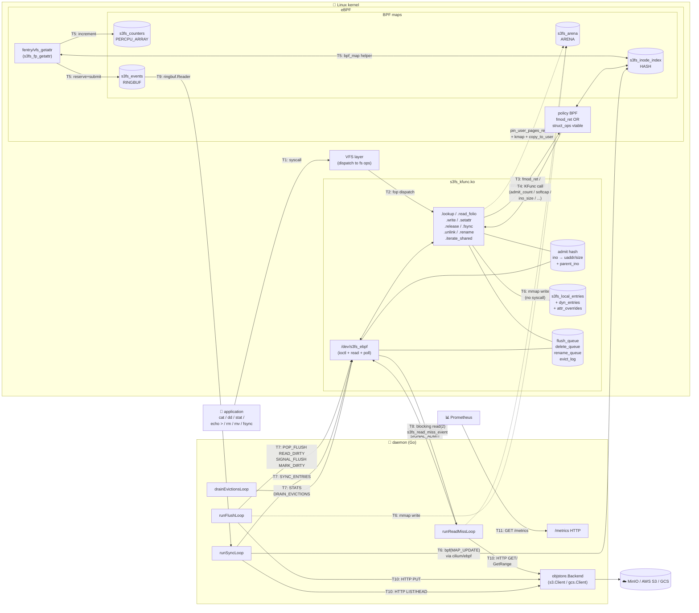
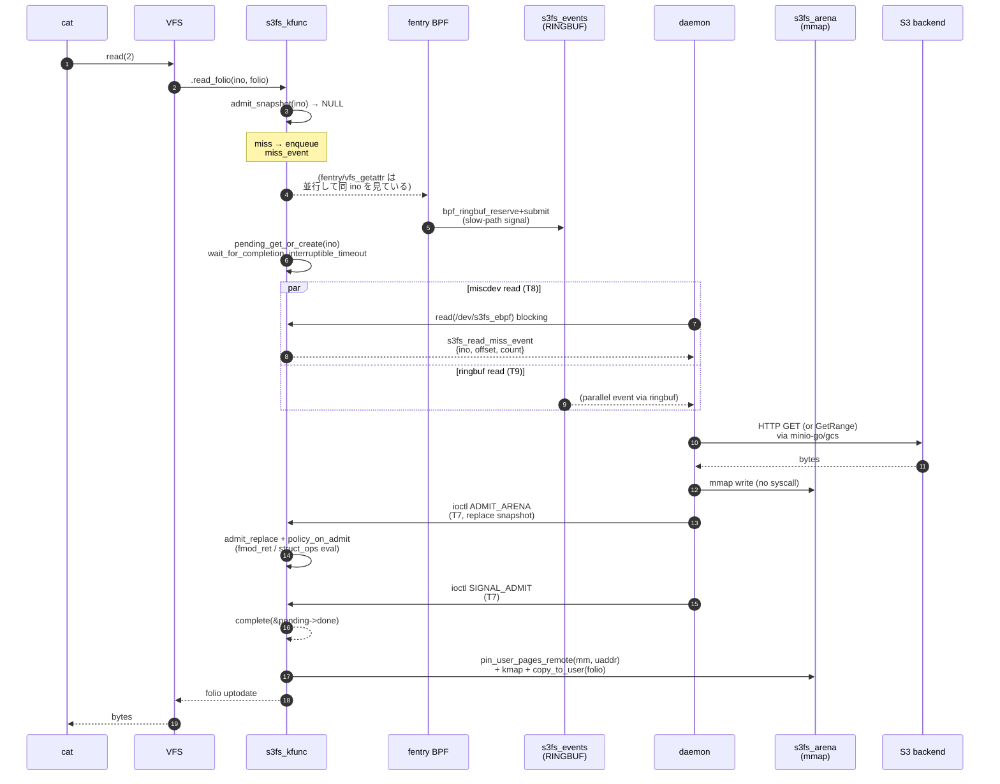
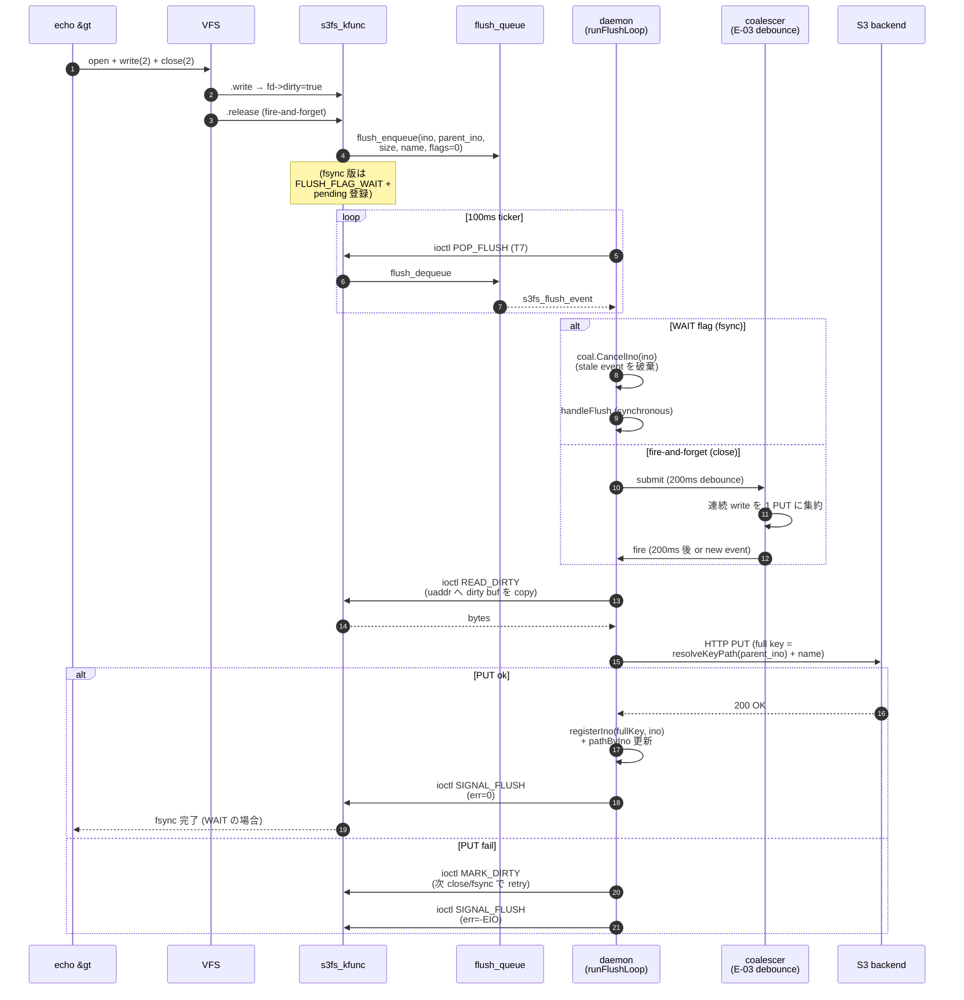
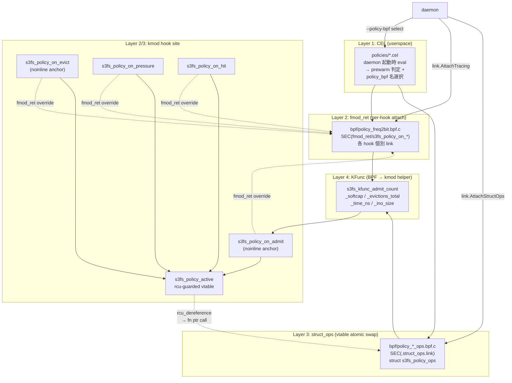
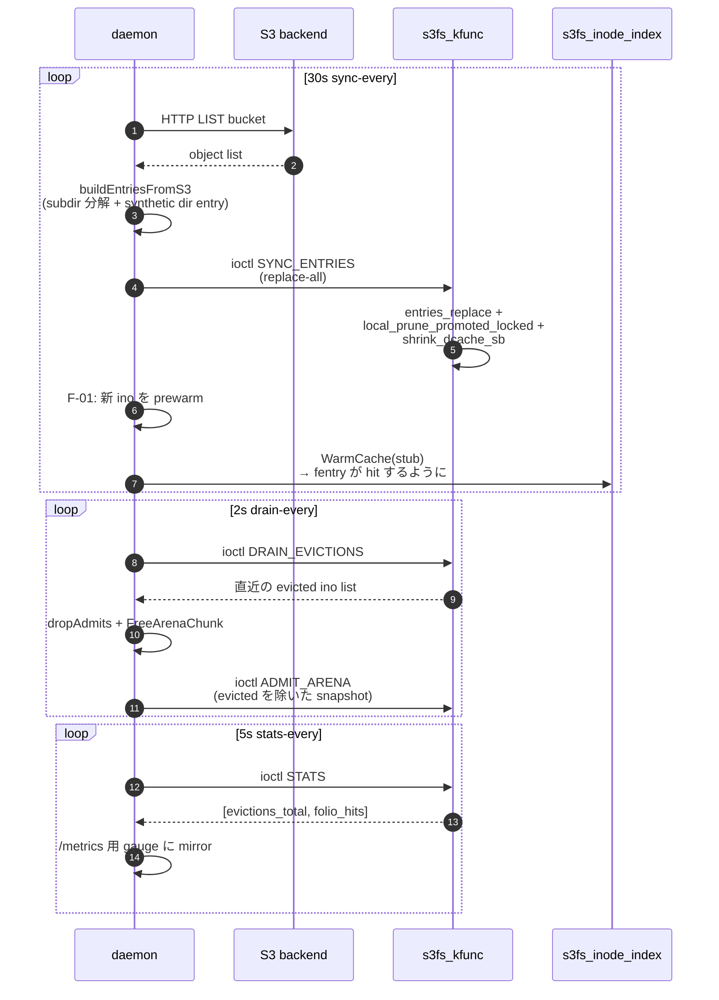

# コンポーネント間通信の全景

s3fs-ebpf は **Linux VFS + kmod (`s3fs_kfunc.ko`) + eBPF プログラム / マップ + userspace daemon + object backend (S3/GCS)** の 5 層構成。各層の間には性質の違う通信路が計 11 種類あり、路ごとに transport / 頻度 / latency 要件が異なる。この doc はそれを 1 か所に列挙し、mermaid.js で図式化する。

**関連 doc**:
- [`read-path-design.md`](read-path-design.md) — Path A/B/C 通信の設計理由
- [`policy-engine-design.md`](policy-engine-design.md) — 4-layer policy dispatch (Layer 1 CEL / Layer 2 fmod_ret / Layer 3 user eBPF / Layer 4 KFunc)
- [`policy-attach-comparison.md`](policy-attach-comparison.md) — fmod_ret vs struct_ops
- [`hook-timings-diagrams.md`](hook-timings-diagrams.md) — 8 タイミング × 3 path のオブジェクト図
- [`ebpf-ecosystem-gaps.md`](ebpf-ecosystem-gaps.md) — ここに見えている ioctl/ringbuf/miscdev 選択の理由

---

## 1. 通信路一覧 (transport 別)

| ID | direction | transport | 用途 | 頻度 | latency 要件 | 参照コード |
|---|---|---|---|---|---|---|
| **T1** | app → VFS | syscall (`open` / `read` / `write` / `stat` / `unlink` / `rename` / `fsync`) | ユーザ操作の入口 | 常時 | μs | Linux VFS |
| **T2** | VFS → kmod | file/inode/address_space/super_operations fop dispatch | mount 経由の全操作 | 常時 | μs | `kmod/vfs_ops.c` |
| **T3** | kmod → BPF (policy) | fmod_ret 経由の関数置換 or struct_ops vtable dispatch | admit / evict / pressure / hit hook | 各 admit_replace | μs | `kmod/tree_traversal.c` (fmod_ret set), `kmod/policy_struct_ops.c` (vtable) |
| **T4** | BPF → kmod | KFunc call | `admit_count` / `softcap` / `evictions_total` / `time_ns` / `ino_size` | policy 判定内 | ns | `kmod/tree_traversal.c` KFunc set |
| **T5** | kmod ↔ BPF map | `bpf_map_lookup/update_elem` (helper), 一部は kmod 側からも書く | inode_index / counters / arena / policy 個別 map | fentry 発火ごと | ns | `bpf/s3fs_fastpath.bpf.c` maps |
| **T6** | daemon → BPF map | mmap (arena bytes 書込) / `bpf(BPF_MAP_UPDATE_ELEM)` (inode_index 書込) | arena 書込は syscall なし。inode_index は cilium/ebpf 経由 | admit ごと | μs | `daemon/internal/ebpf/loader.go` `AdmitContent` / `WarmCache` |
| **T7** | daemon → kmod | **ioctl on `/dev/s3fs_ebpf`** (12 種類、下表) | table push、waiter wake、queue pop、stats read | miss/flush ごと | μs | `daemon/cmd/s3fs-ebpf/{admit_arena,flush_loop,delete_loop,sync_entries}.go` |
| **T8** | kmod → daemon (event) | miscdev **`read(2)` blocking** on `/dev/s3fs_ebpf` | read-miss event stream (`s3fs_read_miss_event`) | miss ごと | μs (blocking) | `runReadMissLoop` in admit_arena.go |
| **T9** | BPF → daemon (event) | **`BPF_MAP_TYPE_RINGBUF`** (`s3fs_events`) | fentry-side slow-path miss event | fentry miss ごと | μs | `bpf/s3fs_fastpath.bpf.c` `s3fs_events` map、daemon 側 `ringbuf.Reader` |
| **T10** | daemon ↔ backend | HTTP (minio-go / cloud.google.com/go/storage) | S3/GCS GET/PUT/DELETE/COPY/HEAD/LIST | miss + flush ごと | ms | `daemon/internal/{s3,gcs}/client.go` |
| **T11** | scraper → daemon | HTTP `GET /metrics` / `/healthz` / `POST /policy/{reload,eval}` | 観測 + 運用 API | 5s (scrape) / 手動 | ms | `daemon/internal/metrics/exporter.go` |

### 1.1 T7 (ioctl) の内訳

`/dev/s3fs_ebpf` 上の 12 個の ioctl (magic `0xE3`)。詳細は `include/s3fs_ebpf_uapi.h`。

| nr | 名前 | 方向 | 目的 | 発火頻度 |
|---:|---|---|---|---|
| 0x01 | `PROBE_KVBASE` | user→kmod | Week 4 (a) spike — arena kern_vm base を読む | 起動時 1 回 |
| 0x02 | `ADMIT_ARENA` | user→kmod | admit table (per-ino userspace range) の replace-all | miss / flush / drain ごと |
| 0x03 | `SIGNAL_ADMIT` | user→kmod | `.read_folio` の pending waiter を wake (err code 付き) | 各 miss の後 |
| 0x04 | `SYNC_ENTRIES` | user→kmod | entry table (dir listing) の replace-all | ~30s / boot 時 |
| 0x05 | `POP_FLUSH` | user←kmod | write-back flush queue から 1 event pop | 100ms ticker |
| 0x06 | `READ_DIRTY` | user↔kmod | per-inode dirty buffer 内容を daemon の uaddr へコピー | 各 flush |
| 0x07 | `MARK_DIRTY` | user→kmod | PUT 失敗時に ino を dirty に戻す (retry) | 稀 (PUT err 時) |
| 0x08 | `STATS` | user↔kmod | kmod 側 counter (evictions_total, folio_hits) を read | 5s ticker |
| 0x09 | `DRAIN_EVICTIONS` | user↔kmod | policy が evict した ino のリング buffer を drain | 2s ticker |
| 0x0A | `SIGNAL_FLUSH` | user→kmod | `.fsync` の pending waiter を wake | 各 flush の後 |
| 0x0B | `POP_DELETE` | user←kmod | `.unlink` から来た delete event を pop | 100ms ticker |
| 0x0C | `POP_RENAME` | user←kmod | `.rename` から来た rename event を pop | 100ms ticker |

### 1.2 BPF map 一覧 (T5 / T6 に登場)

| map name | type | writer | reader | 用途 |
|---|---|---|---|---|
| `s3fs_arena` | `BPF_MAP_TYPE_ARENA` | daemon (mmap 経由) | BPF prog + kmod (GUP over user_vm) | 実データ blob 領域 |
| `s3fs_inode_index` | `BPF_MAP_TYPE_HASH` | daemon (WarmCache) | fentry BPF | ino → arena_offset (stub) |
| `s3fs_counters` | `PERCPU_ARRAY` | fentry BPF | daemon (sample) | fast/slow hit counter |
| `s3fs_events` | `BPF_MAP_TYPE_RINGBUF` | fentry BPF | daemon (ringbuf.Reader) | slow-path miss event stream (T9) |
| `policy_stats` | `PERCPU_ARRAY` | policy BPF | daemon (sample) | policy 発火回数 |
| `freq2bit_counter` / `s3fifo3_state` / `sieve_visited` / ... | 各 policy 固有 | policy BPF | policy BPF (self) | policy 内部 state |

---

## 2. 上位コンポーネント図

**読み方の凡例**:

- 実線 → : syscall / helper / HTTP など明示的な呼び出し
- 点線 -.-> : shared memory 経由 (arena mmap は syscall なし)
- 太字 ID (T1..T11) は上表と対応

---

## 3. Path C 読み込み (miss → S3 → admit → resume)

`cat /mnt/s3demo/new-file.txt` のような **初回 read** の全 handshake。ioctl / ringbuf / miscdev / mmap / HTTP がこの 1 コマンドで全部登場する。

`docs/read-path-design.md §3` の当初見積 210 LOC が実測 480 LOC になった理由の 1 つがこの 3-段 upcall pattern の実装コスト (`docs/lessons-learned.md §2.3`)。

---

## 4. Write flush (close → PUT → sync 促進)

`echo hi > /mnt/s3demo/foo.txt` の close (fire-and-forget) と `fsync(fd)` (blocking) の 2 semantics を同 flush queue で捌く。

WAIT flag と coalescer の分岐は E-03 実装 (`docs/week4c-implementation-notes.md`)。coalescer が「バースト close を 1 PUT に集約」を実現 (bench で 1141 close → 1 PUT を実測、`docs/backlog.md J-05` 参照)。

---

## 5. Policy engine dispatch (Layer 1〜4)

BPF 側 hook が 4 種類 (`on_admit` / `on_evict` / `on_pressure` / `on_hit`) あり、fmod_ret と struct_ops の 2 attach 方式が共存する。KFunc は BPF → kmod の逆方向 helper。

fmod_ret と struct_ops の trade-off は `docs/policy-attach-comparison.md`。両者が同時 attach 可能 (kmod 側 call site は両方 evaluate) で、meetup demo では struct_ops の atomic swap narrative を推奨 (§3)。

---

## 6. Sync + eviction feedback (30s 巡回)

periodic 系の 2 loop はそれぞれ独立 ticker で回り、通信路も並列。

evict feedback (drain) を持たないと、daemon が再送する admit と kmod policy の evict が oscillation で永久ループする (`docs/backlog.md P-13` の解決点)。5s stats は Grafana panel 20/21 の folio_hits gauge を駆動。

---

## 7. 補足: 「USER_RINGBUF で ioctl 置換」の検討

上図の T7 (ioctl) は 12 種類あるが、それらを `BPF_MAP_TYPE_USER_RINGBUF` に置換して syscall overhead を削れるか、という議論は現時点で **効果なし** と判定している。理由:

- **SIGNAL_ADMIT / SIGNAL_FLUSH** は blocking waiter を起こす semantics で、"drain trigger" を BPF 側で持てない
- 現行 ioctl の overhead (~500ns-1μs) は Path C 全体 (S3 Get ~5-30ms 支配) の 0.02% 以下
- **将来** の per-request event stream / userspace-driven policy voting なら USER_RINGBUF が本命

詳細は [`ebpf-ecosystem-gaps.md §1-§4`](ebpf-ecosystem-gaps.md#1-bpf_arena--一番苦しんだ領域) の trade-off 議論。

---

## 8. 更新運用

- kmod / daemon / BPF program で新しい通信路を追加したら **§1 の一覧表と該当 mermaid 図の両方** を更新
- ioctl を追加する場合は §1.1、BPF map を追加する場合は §1.2 も更新
- 大きな path (read-miss / flush / policy) の handshake を変えたら §3-§5 の sequence 図を編集
