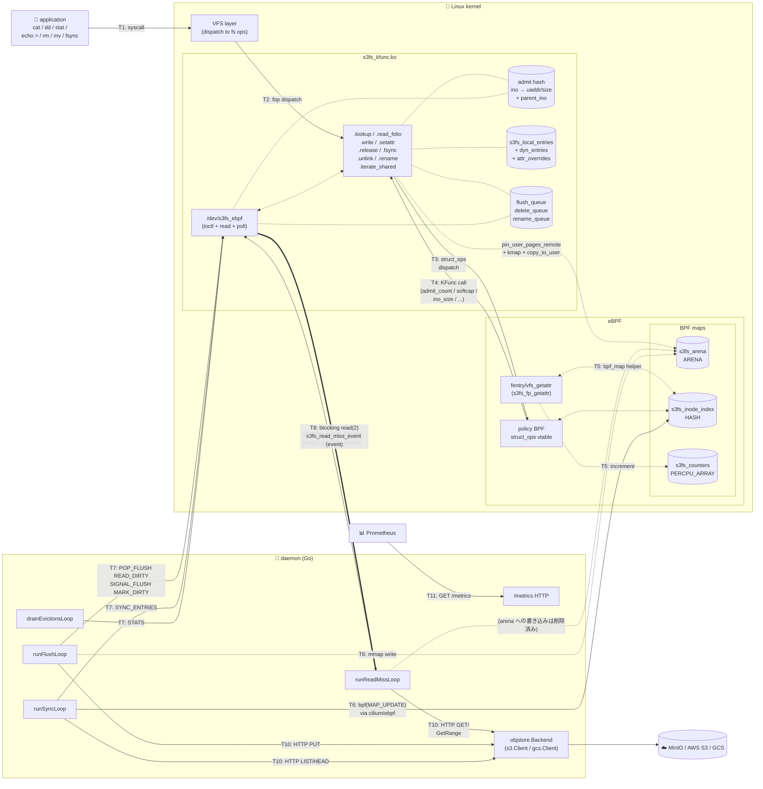
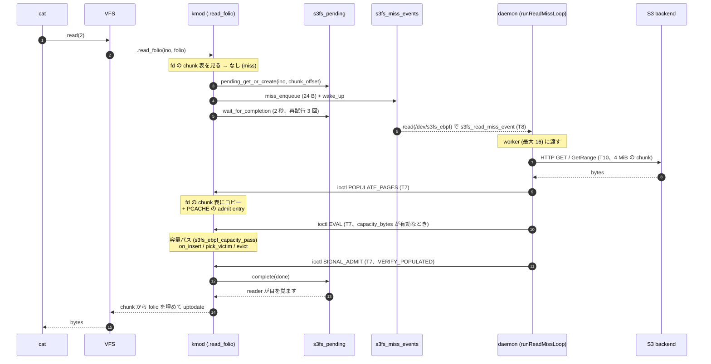
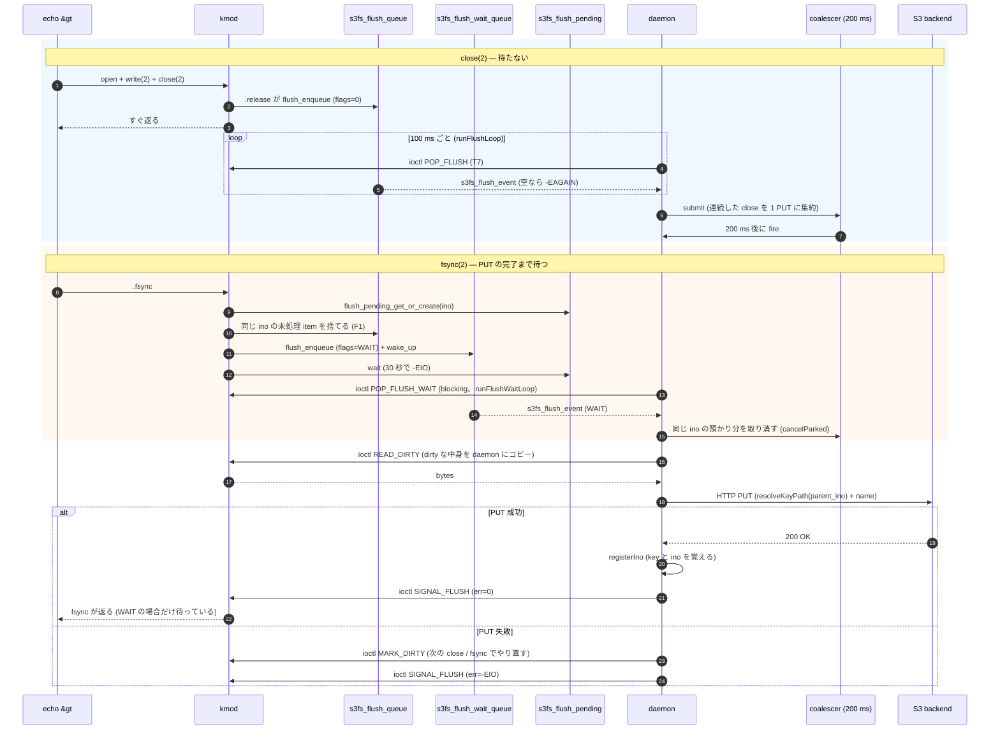
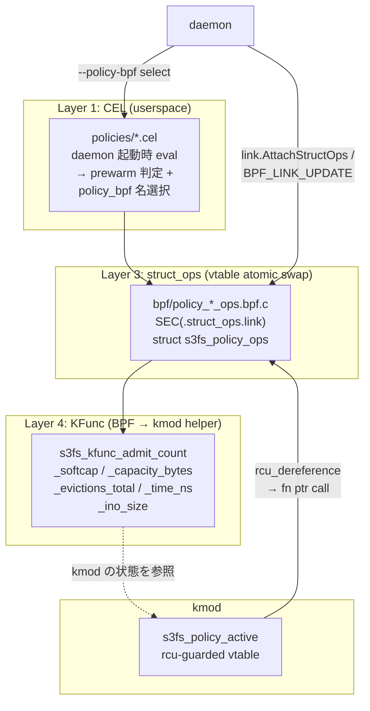
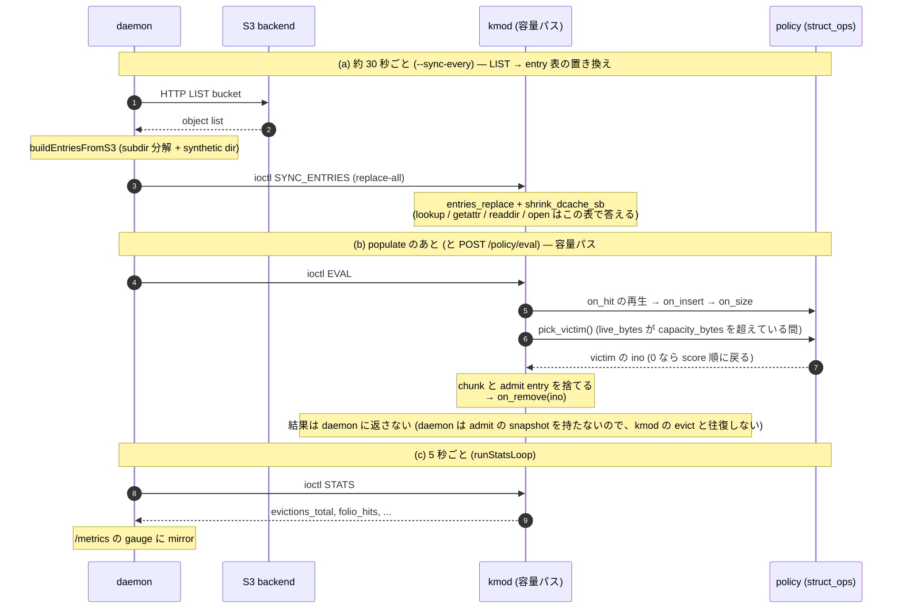

# コンポーネント間通信の全景

s3fs-ebpf は **Linux VFS + kmod (`s3fs_kfunc.ko`) + eBPF プログラム / マップ + userspace daemon + object backend (S3/GCS)** の 5 層構成。各層の間には性質の違う通信路が計 11 種類あり、路ごとに transport / 頻度 / latency 要件が異なる。この doc はそれを 1 か所に列挙し、mermaid.js で図式化する。

**関連 doc**:
- [`daemon-kmod-messaging.md`](daemon-kmod-messaging.md) — daemon と kmod の間のメッセージを、イベント (miss / flush / fsync / unlink / rename / sync / evict) とデータ構造 (キュー、pending) で整理した図つきの見取り図。**まずここ**
- [`read-path-design.md`](read-path-design.md) — Path A/B/C 通信の設計理由
- [`policy-engine-design.md`](policy-engine-design.md) — policy dispatch (CEL で policy を選び、struct_ops の vtable で呼び、KFunc で kmod の状態を読む。fmod_ret の層は issue #35 で削除済み)
- [`policy-attach-comparison.md`](policy-attach-comparison.md) — fmod_ret vs struct_ops (fmod_ret は削除済み。比較は当時の記録)
- [`hook-timings-diagrams.md`](hook-timings-diagrams.md) — 8 タイミング × 3 path のオブジェクト図
- [`../dev-notes/ebpf-ecosystem-gaps.md`](../dev-notes/ebpf-ecosystem-gaps.md) — ここに見えている ioctl/ringbuf/miscdev 選択の理由

---

## 1. 通信路一覧 (transport 別)

| ID | direction | transport | 用途 | 頻度 | latency 要件 | 参照コード |
|---|---|---|---|---|---|---|
| **T1** | app → VFS | syscall (`open` / `read` / `write` / `stat` / `unlink` / `rename` / `fsync`) | ユーザ操作の入口 | 常時 | μs | Linux VFS |
| **T2** | VFS → kmod | file/inode/address_space/super_operations fop dispatch | mount 経由の全操作 | 常時 | μs | `kmod/vfs_ops.c` |
| **T3** | kmod → BPF (policy) | struct_ops vtable dispatch | admit / evict / pressure / hit hook、さらに insert / size / remove / pick_victim (AC-58 / AC-66) | 各 admit_replace | μs | `kmod/policy_struct_ops.c` (vtable) |
| **T4** | BPF → kmod | KFunc call | `admit_count` / `softcap` / `capacity_bytes` / `evictions_total` / `time_ns` / `ino_size` | policy 判定内 | ns | `kmod/tree_traversal.c` KFunc set |
| **T5** | kmod ↔ BPF map | `bpf_map_lookup/update_elem` (helper), 一部は kmod 側からも書く | inode_index / counters / arena / policy 個別 map | fentry 発火ごと | ns | `bpf/s3fs_fastpath.bpf.c` maps |
| **T6** | daemon → BPF map | mmap (arena bytes 書込) / `bpf(BPF_MAP_UPDATE_ELEM)` (inode_index 書込) | arena 書込は syscall なし。inode_index は cilium/ebpf 経由 | admit ごと | μs | `daemon/internal/ebpf/loader.go` `AdmitContent` / `WarmCache` |
| **T7** | daemon → kmod | **ioctl on `/dev/s3fs_ebpf`** (13 種類、下表) | table push、waiter wake、queue pop、stats read | miss/flush ごと | μs | `daemon/cmd/s3fs-ebpf/{admit_arena,flush_loop,delete_loop,sync_entries}.go` |
| **T8** | kmod → daemon (event) | miscdev **`read(2)` blocking** on `/dev/s3fs_ebpf` | read-miss event stream (`s3fs_read_miss_event`) | miss ごと | μs (blocking) | `runReadMissLoop` in admit_arena.go |
| **T9** | ~~BPF → daemon (event)~~ | ~~`BPF_MAP_TYPE_RINGBUF` (`s3fs_events`)~~ | **削除済み (2026-11-05)**。fentry の miss event を daemon が処理するのは root の ino=1 の warm だけだった | — | — | — |
| **T10** | daemon ↔ backend | HTTP (minio-go / cloud.google.com/go/storage) | S3/GCS GET/PUT/DELETE/COPY/HEAD/LIST | miss + flush ごと | ms | `daemon/internal/{s3,gcs}/client.go` |
| **T11** | scraper → daemon | HTTP `GET /metrics` / `/healthz` / `POST /policy/{reload,eval}` | 観測 + 運用 API | 5s (scrape) / 手動 | ms | `daemon/internal/metrics/exporter.go` |

### 1.1 T7 (ioctl) の内訳

`/dev/s3fs_ebpf` 上の 13 個の ioctl (magic `0xE3`)。詳細は `include/s3fs_ebpf_uapi.h`、構造体のフィールドと miss イベントの flags は [`dev-s3fs-ebpf-protocol.md`](dev-s3fs-ebpf-protocol.md)。

| nr | 名前 | 方向 | 目的 | 発火頻度 |
|---:|---|---|---|---|
| 0x02 | `EVAL` | user→kmod | kmod の容量 / policy パスを今走らせる (旧 `ADMIT_ARENA`、nr を引き継いだ。引数なし) | 各 miss の populate の後、`POST /policy/eval` |
| 0x03 | `SIGNAL_ADMIT` | user→kmod | `.read_folio` の pending waiter を wake (err code 付き) | 各 miss の後 |
| 0x04 | `SYNC_ENTRIES` | user→kmod | entry table (dir listing) の replace-all | ~30s / boot 時 |
| 0x05 | `POP_FLUSH` | user←kmod | write-back flush queue から 1 event pop | 100ms ticker |
| 0x06 | `READ_DIRTY` | user↔kmod | per-inode dirty buffer 内容を daemon の uaddr へコピー | 各 flush |
| 0x07 | `MARK_DIRTY` | user→kmod | PUT 失敗時に ino を dirty に戻す (retry) | 稀 (PUT err 時) |
| 0x08 | `STATS` | user↔kmod | kmod 側 counter (evictions_total, folio_hits) を read | 5s ticker |
| 0x0A | `SIGNAL_FLUSH` | user→kmod | `.fsync` の pending waiter を wake | 各 flush の後 |
| 0x0B | `POP_DELETE` | user←kmod | `.unlink` から来た delete event を pop | 100ms ticker |
| 0x0C | `POP_RENAME` | user←kmod | `.rename` から来た rename event を pop | 100ms ticker |
| 0x0D | `POP_FLUSH_WAIT` | user←kmod | `POP_FLUSH` の blocking 版。fsync (FLUSH_FLAG_WAIT) の event だけを待って pop (S-08) | fsync ごと |
| 0x0E | `POPULATE_PAGES` | user→kmod | pcache モード: 取得した範囲を fd の chunk にコピーし、PCACHE の admit entry を入れる (AB-04) | 各 miss の後 |
| 0x0F | `DIRTY_LAYOUT` | user↔kmod | dirty な file の chunk ごとの状態 (data / hole / remote) を読む (AC-51 の partial flush) | 各 flush (`--partial-modify`) |
| 0x10 | `READ_DIRTY_RANGE` | user↔kmod | `READ_DIRTY` の offset 指定版。data / hole の chunk だけを読む (AC-51) | 各 flush (`--partial-modify`) |

ioctl のほかに、daemon は起動時に kmod の module param (`/sys/module/s3fs_kfunc/parameters/`) へ `softcap` / `capacity_bytes` / `partial_modify` を書く (`daemon/cmd/s3fs-ebpf/kmod_params.go`)。起動時だけの設定なので通信路には数えていない。

### 1.2 BPF map 一覧 (T5 / T6 に登場)

| map name | type | writer | reader | 用途 |
|---|---|---|---|---|
| `s3fs_arena` | `BPF_MAP_TYPE_ARENA` | daemon (stub の書き込みだけ) | BPF prog | 中身は置かない (arena モードは削除済み)。inode_index の stub と、arena のデモ / テストだけ |
| `s3fs_inode_index` | `BPF_MAP_TYPE_HASH` | daemon (WarmCache) | fentry BPF | ino → arena_offset (stub) |
| `s3fs_counters` | `PERCPU_ARRAY` | fentry BPF | daemon (sample) | fast/slow hit counter |
| `policy_stats` | `PERCPU_ARRAY` | policy BPF | daemon (sample) | policy 発火回数 |
| `freq2bit_counter` / `s3fifo3_state` / `sieve_visited` / ... | 各 policy 固有 | policy BPF | policy BPF (self) | policy 内部 state |

---

## 2. 上位コンポーネント図

**読み方の凡例**:

矢印は意味で 3 種類に分けている。

- **太線 `==>` : イベント・データの流れ** (miss の通知、`read(2)` で運ばれる `s3fs_read_miss_event`)
- **実線 `-->` : 呼び出し** (syscall、fop の dispatch、KFunc / ioctl / HTTP の呼び出し)
- **点線 `-.->` / `-.-` : 参照** (map や表の読み書き、arena の mmap と GUP。呼び出しは起こさない)
- ID (T1..T11) は上表と対応
- シーケンス図 (§3、§4、§6) は `->>` が呼び出し・操作、`-->>` が戻り・イベント・データ

---

## 3. Path C 読み込み (miss → S3 → populate → resume)

`cat /mnt/s3demo/new-file.txt` のような **初回 read** の全 handshake。**現行の流れ (pcache モード、`--arena-metadata-only`)** を描く。通るのは kmod の `.read_folio`、`/dev/s3fs_ebpf` (T8 の `read(2)` と T7 の ioctl)、daemon、S3 だけで、**BPF プログラムと ringbuf (T9) は関与しない**。arena モードとの差は下の表。メッセージの種類とキューは [`daemon-kmod-messaging.md`](daemon-kmod-messaging.md) §4。

- `EVAL` は `enforceCapacityAfterPopulate` (`kmod_dev.go`)。kmod が capacity モードのときだけで、populate した直後に、まだ pending の間に容量を守る (AC-45 C2)。
- `SIGNAL_ADMIT` は `VERIFY_POPULATED` 付きで送る。容量パスや同じ ino の別の handler が、populate したばかりの chunk を evict していたら `-EAGAIN` が返り、daemon は populate し直す (`read_miss_repopulates_total`)。
- 4 MiB を超える object は、range GET を並列にし、取れた chunk から populate と `SIGNAL_ADMIT` を繰り返す (AC-52、`admit_chunkload.go`)。

**arena モードは削除した** (2026-11-05、v2 Phase 2): 中身を daemon が arena に mmap で書き、kmod が GUP で読む方式。中身の受け渡しは `POPULATE_PAGES` だけになり、`ADMIT_ARENA` は `count == 0` (daemon の mm を記録して upcall を有効にし、容量の pass を走らせる) 以外を `-EINVAL` で断る。

**BPF の ringbuf (T9) は削除した** (2026-11-05): fentry の miss event を daemon が処理するのは root ino=1 の warm だけで、kmod は ringbuf を見ず、read の miss の完了は T8 + T7 だけで決まっていた。

`docs/design/read-path-design.md §3` の当初見積 210 LOC が実測 480 LOC になった理由の 1 つがこの 3-段 upcall pattern (kmod → miscdev の queue → daemon が S3 → ioctl で起こす) の実装コスト (`docs/dev-notes/lessons-learned.md §2.3`)。

---

> **確認状況 (2026-11-05):** §2〜§4、§6 は現行コード (pcache モード) を読んで直したもので、kmod をロードした実機では動かしていない。arena モードの流れは今回は追い直していない (§3 の差の表は `readmiss.go` の分岐からの要約)。§4 の PUT 後の arena への書き直しが書いた直後の read を支えること、その影響は未確認 (backlog AC-82)。§5 は今回の変更の対象外 (線種の変更のみ)。

## 4. Write flush (close → PUT → sync 促進)

`echo hi > /mnt/s3demo/foo.txt` の close (fire-and-forget) と `fsync(fd)` (blocking) の 2 semantics を同 flush queue で捌く。

fsync は専用の queue (`s3fs_flush_wait_queue`) と blocking の `POP_FLUSH_WAIT` で、ticker の遅れと coalescer の debounce を通らない。close の分と同じ ino の `handleFlush` は直列にし、`.create` の 0 byte の placeholder が fsync の PUT のあとに PUT されてオブジェクトを空にしないようにしている (F1、`flush_order.go`、`docs/kmod-pcache-invariants.md` の F1 / W3)。**PUT のあとの arena への書き直し (コードで確認、2026-11-05):** `handleFlush` (`flush_loop.go`) は、全体の PUT が成功すると、`--arena-metadata-only` かどうかに関係なく、書いた中身を arena にコピーして `ADMIT_ARENA` で admit し直す (`AdmitContent` + `replaceAdmit`)。省かれるのは `--partial-modify` で処理済みの flush (`dropAdmitIno` で arena の古い分を捨てる) と、`progs == nil` のときだけ。
- **書いた直後の read を支える (AC-82、2026-11-05):** `SIGNAL_FLUSH` が成功したとき、kmod は chunk の `populated` を立て、**populated な chunk の連続した範囲ごとに PCACHE の admit entry を入れる** (`fd->lock` の下、R1)。書いた直後の `.read_folio` は chunk から返り、S3 への upcall は出ない。以前は daemon が PUT のあと中身を arena にコピーして `ADMIT_ARENA` で admit し直し (`AdmitContent`)、書いた直後の read はその arena のコピーを GUP で読んでいた。arena の消費と、満杯のときの `flush_errors_total` の誤計上は、削除で解消した。
- 書いた直後の read の遅延と S3 の GET 数、新規 100 MiB の fsync の時間は**未計測** (`make test-regression` は通る)。

E-03 の実装 (`docs/journal/week4c-implementation-notes.md`)。coalescer が「バースト close を 1 PUT に集約」を実現 (bench で 1141 close → 1 PUT を実測、`docs/journal/backlog-archive.md J-05` 参照)。

**§4 の `s3fs_flush_event` が (削除済みの) BPF の ringbuf と別 transport になっている理由**: kmod C context (`.release` / `.fsync` → `s3fs_ebpf_flush_pop` = `kmod/vfs_ops.c:1338`) の producer なので、BPF prog 専用の `bpf_ringbuf_reserve/submit` は使えない (`bpf_ringbuf_output` は kmod 側から呼べるが、以下 2 要件が満たせない):

1. **PUT 失敗時の再登録** — daemon が `ioctl MARK_DIRTY` を送ると kmod は自 queue に再 enqueue できる (`kmod/s3fs_ebpf_dev.c` MARK_DIRTY handler)。ringbuf は fire-and-forget なので再登録経路が daemon 側自前になり複雑化する
2. **fsync waiter の対称 wake path** — `SIGNAL_FLUSH` ioctl で kmod の `pending->done` を `complete()` する。BPF ringbuf は消費側 (daemon) の read 完了を kmod 側から観測する API がない

### 4.1 event transport 対応表 (T7/T8 の使い分け)

| producer | consumer | transport | 対応 event | 選定理由 |
|---|---|---|---|---|
| kmod `.read_folio` / `.open` (`open_check`) | daemon | miscdev `read(2)` (T8) | `s3fs_read_miss_event` (flags に `OPEN_CHECK`) | read の miss と同じ待ち手の形 (`s3fs_pending`) |
| kmod `.read_folio` | daemon | miscdev `read(2)` blocking (T8) | `s3fs_read_miss_event` | 単発 event の blocking read で自然に back-pressure |
| kmod `.release` | daemon | miscdev `ioctl POP_FLUSH` (T7、100 ms) | `s3fs_flush_event` | 再登録 (MARK_DIRTY) と waiter wake (SIGNAL_FLUSH) の対称 API が必要 |
| kmod `.fsync` | daemon | miscdev `ioctl POP_FLUSH_WAIT` (T7、blocking) | `s3fs_flush_event` (WAIT) | ticker の遅れを避ける。専用の queue と wait queue |
| kmod `.unlink` | daemon | miscdev `ioctl POP_DELETE` (T7) | delete event | flush と同じ理由 (再登録は不要だが対称性優先) |
| kmod `.rename` | daemon | miscdev `ioctl POP_RENAME` (T7) | rename event | 同上 |

**統一の余地**: flush / delete / rename の queue を 1 本の message queue に寄せる案は [`redesign-v2-simplify.md`](redesign-v2-simplify.md)。

---

## 5. Policy engine dispatch

BPF 側の policy は struct_ops (`struct s3fs_policy_ops`、`kmod/policy_struct_ops.h`) の 1 方式だけ。hook は `on_admit` / `on_evict` / `on_pressure` / `on_hit` に、AC-58 で `on_insert` / `on_remove` / `pick_victim`、AC-66 で `on_size` が足された。`pick_victim` を持つ policy は容量超過のときに victim を自分で選ぶ (`docs/design/ac58-pick-victim.md`)。KFunc は BPF → kmod の逆方向 helper。差し替えは `BPF_LINK_UPDATE` 1 回 (RCU ポインタ 1 本)。fmod_ret の層は issue #35 で削除した (kmod に `s3fs_policy_on_*` の anchor はない。`docs/design/policy-attach-comparison.md` は当時の比較の記録)。

policy の各 hook の呼び出し順と map の使い方は [`policy-bpf-maps.md`](policy-bpf-maps.md) §1。

---

## 6. Sync + eviction feedback

periodic 系は独立 ticker で回る。**メインは (b) の 容量パス** (policy の victim を kmod が evict する)。

- `pick_victim` を持たない policy (score 型) は、`on_evict(ino)` を全件に呼び、score の降順で捨てる (`policy-bpf-maps.md` §4)。`capacity_bytes` が 0 (既定) の legacy モードでは、softcap を超えたときに `on_evict` の vote で捨てる。
- 以前は kmod の evict を `evict_log` + `DRAIN_EVICTIONS` で daemon に返していた (daemon が再送する admit と kmod の evict の oscillation を止めるため、P-13)。daemon が admit の snapshot を持たなくなったので (2026-11-05、v2 Phase 3b)、`evict_log` と `DRAIN_EVICTIONS` は削除した。
- 実装の位置: 容量パスは `kmod/vfs/capacity_evict.inc.c` の `s3fs_ebpf_capacity_pass` (旧 `admit_replace`)。

---

## 7. 補足: 「USER_RINGBUF で ioctl 置換」の検討

上図の T7 (ioctl) は 16 種類あるが、それらを `BPF_MAP_TYPE_USER_RINGBUF` に置換して syscall overhead を削れるか、という議論は現時点で **効果なし** と判定している。理由:

- **SIGNAL_ADMIT / SIGNAL_FLUSH** は blocking waiter を起こす semantics で、"drain trigger" を BPF 側で持てない
- 現行 ioctl の overhead (~500ns-1μs) は Path C 全体 (S3 Get ~5-30ms 支配) の 0.02% 以下
- **将来** の per-request event stream / userspace-driven policy voting なら USER_RINGBUF が本命

詳細は [`../dev-notes/ebpf-ecosystem-gaps.md §1-§4`](../dev-notes/ebpf-ecosystem-gaps.md#1-bpf_arena--一番苦しんだ領域) の trade-off 議論。

---

## 8. 更新運用

- kmod / daemon / BPF program で新しい通信路を追加したら **§1 の一覧表と該当 mermaid 図の両方** を更新
- ioctl を追加する場合は §1.1 と `dev-s3fs-ebpf-protocol.md` §3、BPF map を追加する場合は §1.2 も更新
- 大きな path (read-miss / flush / policy) の handshake を変えたら §3-§5 の sequence 図を編集
