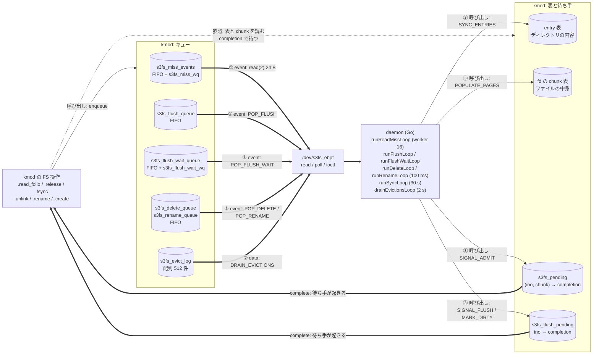
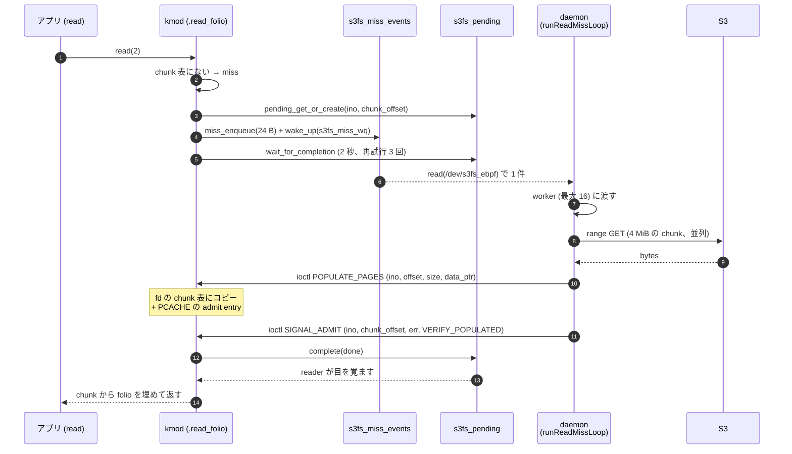
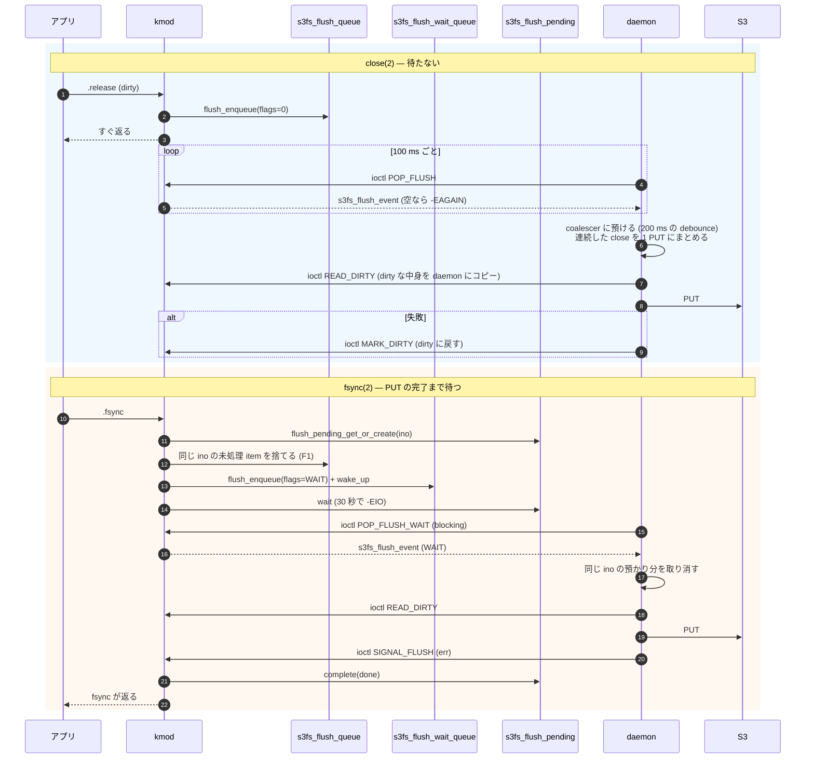
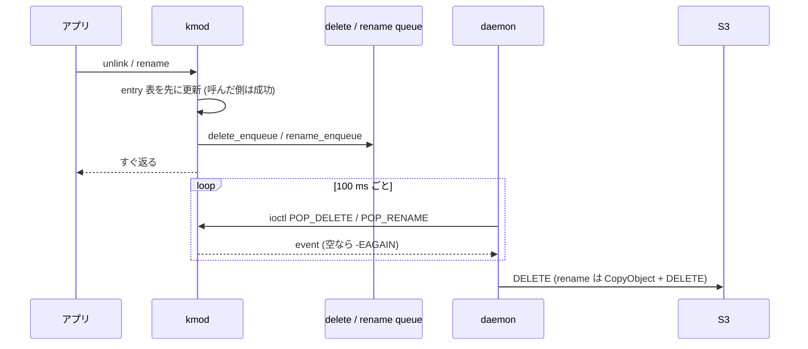
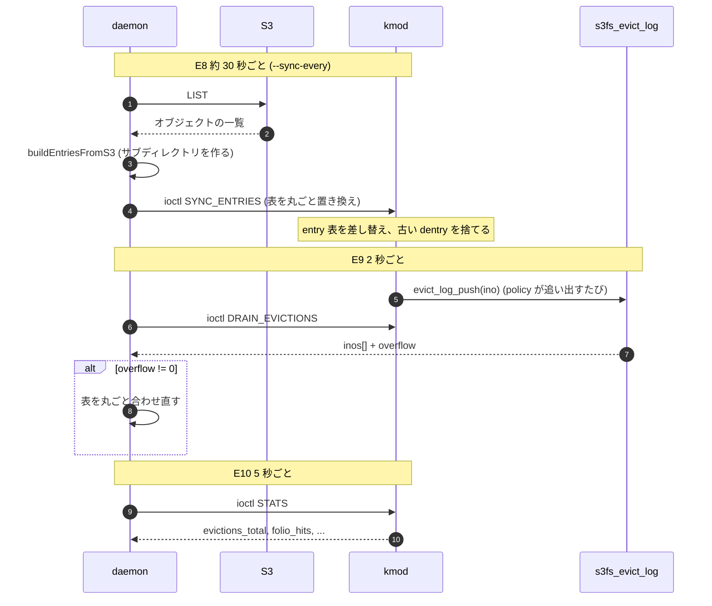
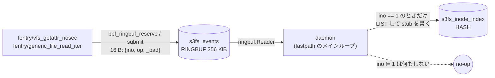

# daemon と FS (kmod) の間のメッセージ: データ構造と基本イベント

2026-11-05。daemon (Go) と FS 本体 (kmod) の間で、どんなメッセージが、どのデータ構造を通って行き来するかを図でまとめる。「イベントごとに、誰が積み、何を通り、誰が処理し、どう完了を知らせるか」が一目で追えることを目的にした。通信路 11 種 (T1〜T11) の全景は [`component-communication.md`](component-communication.md)、構造体のフィールドは [`dev-s3fs-ebpf-protocol.md`](dev-s3fs-ebpf-protocol.md)、定義の正本は `include/s3fs_ebpf_uapi.h`。この doc はその間をつなぐ「イベント中心」の見取り図で、現行の pcache モード (`--arena-metadata-only`) を前提にする。arena モードの差は §8。

---

## 1. 全体像: 3 本の通り道と、そこにあるデータ構造

daemon と kmod の通信は、ほとんどが 1 つのデバイス `/dev/s3fs_ebpf` (miscdevice) を通る。BPF の ringbuf はおまけの経路で、FS の動作には要らない (§7)。

**矢印の凡例** (この doc の全フローチャートで共通。シーケンス図は `->>` が呼び出し・操作、`-->>` が戻り・イベント・データ):

| 矢印 | 意味 | 例 |
|---|---|---|
| `==>` 太線 | **イベント・データの流れ** (中身が運ばれる、または待ち手が起きる) | miss の event、`POP_*` で取り出す item、`complete` による起床 |
| `-->` 実線 | **呼び出し** (関数・フック・ioctl を起動する) | FS 操作が enqueue を呼ぶ、daemon が ioctl を叩く |
| `-.->` 点線 | **参照** (状態や map を読む / 書く。起動はしない) | FS 操作が chunk 表を読む |

| 番号 | 方向 | 仕組み | 性質 |
|---|---|---|---|
| ① | kmod → daemon | `/dev/s3fs_ebpf` の `read(2)`。待ち行列は `s3fs_miss_wq`、`poll(2)` も可 | **押し出し (push)**。read の miss だけ。1 回の `read` で 1 件 (24 B)、バッファが小さいと `-EINVAL` |
| ② | kmod → daemon | ioctl の `POP_*` / `DRAIN_*` / `READ_DIRTY*` | **取りに行く (pull)**。daemon が ticker で叩く。空なら `-EAGAIN`。blocking 版は `POP_FLUSH_WAIT` だけ |
| ③ | daemon → kmod | ioctl (データを渡す、表を置き換える、待っている syscall を起こす) | **応答**。起こす相手は kmod の completion |

要点は 3 つ。

- kmod から「押す」のは miss だけ。write-back、unlink、rename、evict は kmod が自分のキューに積み、daemon が取りに来る。
- 呼んだプロセスを待たせるのは 2 種類だけ (read の miss と open の確認は `s3fs_pending`、fsync は `s3fs_flush_pending`)。どちらも完了は ③ の ioctl で起こす。
- キューは **全部 kmod のメモリ**。件数の上限はなく (`kmalloc` / `kzalloc` で 1 件ずつ。flush・delete・rename の event は、確保に失敗すると黙って捨てられる。miss は `-ENOMEM` を返す)、daemon が落ちると未処理分は失われる。上限があるのは `s3fs_evict_log` だけ (512 件、溢れたら `overflow` を数える)。

---

## 2. 基本イベントの一覧

「誰が積むか」「何を通るか」「誰が処理するか」「どう終わるか」をイベントごとに並べる。呼んだプロセスが待つものを **同期**、待たないものを **非同期** と書く。

| # | イベント | きっかけ | 積む側 → キュー | 取り出し | メッセージ | 処理する daemon 側 | 完了の知らせ | 待ち |
|---|---|---|---|---|---|---|---|---|
| E1 | **read の miss** | `.read_folio` で chunk がない | kmod → `s3fs_miss_events` | `read(2)` (push) | `s3fs_read_miss_event` (ino, offset, count, flags=0) | `runReadMissLoop` → `handleReadMiss` (S3 の range GET) | `POPULATE_PAGES` で中身を入れ、`SIGNAL_ADMIT` | **同期** |
| E2 | 変更の前の読み込み | write / truncate の前に、持っていない部分が要る (AC-50) | 同上 | 同上 | flags に `FOR_WRITE` (0x1) | 同上。4 MiB の chunk を入れる | 同上 | **同期** |
| E3 | open の存在確認 | `open(2)` (O_CREAT なし) で `open_check=1` | 同上 | 同上 | flags に `OPEN_CHECK` (0x4)。pending のキーは `chunk_offset = ~0` | `handleOpenCheck` (HEAD) | `SIGNAL_ADMIT` の `err` (0 / `-ENOENT` / `-EIO`) | **同期** |
| E4 | close の書き戻し | `.release` と `.create` の dirty な fd | kmod → `s3fs_flush_queue` | `POP_FLUSH` (100 ms ticker) | `s3fs_flush_event` (ino, parent_ino, size, name, flags=0) | `runFlushLoop` → coalescer (200 ms) → `handleFlush` (PUT) | なし。失敗は `MARK_DIRTY` で dirty に戻す | **非同期** |
| E5 | fsync の書き戻し | `.fsync` | kmod → `s3fs_flush_wait_queue` + `s3fs_flush_pending` | `POP_FLUSH_WAIT` (blocking) | `s3fs_flush_event` (flags に `WAIT` 0x1) | `runFlushWaitLoop` → `handleFlush` (PUT) | `SIGNAL_FLUSH` の `err` | **同期** (30 秒で `-EIO`) |
| E6 | 削除 | `.unlink` | kmod → `s3fs_delete_queue` | `POP_DELETE` (100 ms) | `s3fs_delete_event` (ino, parent_ino, name) | `runDeleteLoop` (S3 の DELETE) | なし | **非同期** |
| E7 | 名前の変更 | `.rename` | kmod → `s3fs_rename_queue` | `POP_RENAME` (100 ms) | `s3fs_rename_event` (ino, 旧 / 新の parent_ino と name) | `runRenameLoop` (CopyObject + DELETE) | なし | **非同期** |
| E8 | ディレクトリの更新 | 約 30 秒ごと (`--sync-every`) と起動時 | daemon が S3 を LIST | `SYNC_ENTRIES` (daemon → kmod) | `s3fs_sync_entry[]` (ino, parent_ino, size, mode, name) | `runSyncLoop` | ioctl の戻り値 | (なし) |
| E9 | evict の報告 | policy が chunk を追い出した | kmod → `s3fs_evict_log` | `DRAIN_EVICTIONS` (2 秒) | `inos[]` (最大 256) + `overflow` | `drainEvictionsLoop` | ioctl の戻り値 | (なし) |
| E10 | 統計の取得 | 5 秒ごと | kmod の counter | `STATS` | `values[]` (evictions_total、folio_hits、…) | `runStatsLoop` → `/metrics` | ioctl の戻り値 | (なし) |

- E1〜E7 は、kmod が **FS の操作の途中で** 積む。E8〜E10 は daemon が **時計で** 起こす (E9 のログだけは kmod が積む)。
- 「ioctl の戻り値」とは、daemon が叩いた ioctl がそのまま結果を返すこと (別の完了通知はない)。
- E1〜E3 が同じ `s3fs_read_miss_event` に相乗りしているのは、「kmod が待っていて、daemon が答える」という形が同じだから。区別は `flags` だけ。

---

## 3. kmod の中のデータ構造

イベントごとに、どのデータ構造に何が入っているか。

| 構造 | 種類 | 鍵 | 入るもの | 消えるとき | ロック |
|---|---|---|---|---|---|
| `s3fs_miss_events` (`kmod/vfs/read_miss.inc.c`) | list (FIFO) | なし | 24 B の `s3fs_read_miss_event` | `read(2)` が 1 件 pop | `s3fs_miss_lock` |
| `s3fs_pending` | hash (16 bucket) | `(ino, chunk_offset)`。bucket は ino だけで決める | reader 1 人以上が待つ completion | `SIGNAL_ADMIT` が `complete` したあと、最後の reader が参照を離す | `s3fs_pending_lock` |
| `s3fs_flush_queue` | list (FIFO) | なし | close の書き戻し (`flags=0`) | `POP_FLUSH` が pop | `s3fs_flush_lock` |
| `s3fs_flush_wait_queue` | list (FIFO) + wait queue | なし | fsync の書き戻し (`flags=WAIT`) | `POP_FLUSH_WAIT` が pop。unload で `-ENODEV` | `s3fs_flush_wait_lock` |
| `s3fs_flush_pending` | hash (16 bucket) | `ino` | fsync 1 回につき 1 つの completion | `SIGNAL_FLUSH` が起こしたとき | `s3fs_flush_pending_lock` |
| `s3fs_delete_queue` / `s3fs_rename_queue` | list (FIFO) | なし | unlink / rename の記録 | `POP_DELETE` / `POP_RENAME` が pop | 各 spinlock |
| `s3fs_evict_log` (`kmod/vfs/admit_table.inc.c`) | 配列 (上限 512) | なし | 追い出した ino | `DRAIN_EVICTIONS` が全部コピーして空にする | `s3fs_evict_log_lock` |

「待つ側」の構造 (`s3fs_pending`、`s3fs_flush_pending`) は、**どちらも「1 つの completion を、複数の待ち手が参照カウントで共有する」** 同じ形。fsync の方が `ino` だけで引くのは、同じファイルの fsync は 1 つずつしか進まないため。

---

## 4. 読み (E1〜E3): miss から起こすまで

### 4.1 read の miss (pcache モード)

- 同じ chunk を同時に読む reader は 1 つの pending を共有し、`SIGNAL_ADMIT` 1 回で全員が起きる。違う chunk の reader は別の pending で、互いに待たない。
- daemon は `read(2)` で受けた event を worker に渡す。worker が 16 全部使われているときは `read` を止めて待つ (kmod 側のキューが伸びるだけで、event は失われない)。
- `SIGNAL_ADMIT` の `err` が負なら、reader にそのエラーが返る。待ち手がいなければ `-ENOENT`。`VERIFY_POPULATED` を付けると、chunk が実際に入っているときだけ起こし、なければ `-EAGAIN` (AC-45)。
- daemon が応えないと、kmod は 2 秒待って再試行し (最大 3 回)、そのあと手元の chunk で埋めるか失敗する (`S3FS_UPCALL_WAIT_JIFFIES`、`S3FS_UPCALL_MAX_RETRIES`)。

### 4.2 変更の前の読み込み (E2) と open の確認 (E3)

E1 と同じ経路で、`flags` だけが違う。

| flags | kmod の動機 | daemon がやること | 起こすときの `err` |
|---|---|---|---|
| `FOR_WRITE` (0x1) | write / truncate の前に、持っていない部分を取る。open は何も読まないため (AC-50) | `offset` を含む 4 MiB の chunk を `POPULATE_PAGES` で入れる | 0、または取得の失敗 |
| `PINNED` (0x2) | fd の中身が、固定した ETag のオブジェクトに依存している。**単独では使わず、上の flag などに付く修飾** (AC-51) | オブジェクトが変わっていたら衝突として扱う。付いていなければ古い pin を捨てて Stat し直してよい | (修飾なので、元の event と同じ) |
| `OPEN_CHECK` (0x4) | O_CREAT でない open で、S3 に存在を確かめる。module param `open_check=1` のとき (既定は 0) | 何も入れず、HEAD するだけ。daemon が自分で作った / rename した key は `localKeys` に覚えておき、そちらを HEAD する | 0 (ある)、`-ENOENT` (404)、`-EIO` |

`OPEN_CHECK` の pending は `chunk_offset = ~0` (read の chunk は 4 MiB の倍数なので衝突しない)。計測への影響は `docs/journal/benchmark-results.md` §18.51。

---

## 5. 書き (E4〜E7): close / fsync / unlink / rename

### 5.1 close と fsync の違い

- close の書き戻しは **取りこぼしても pull の次の周期で拾う**。fsync は専用の queue と blocking の ioctl で、ticker の遅れ (最大 100 ms + 200 ms) を避ける。
- **順序の制御が要る理由:** `.create` は 0 byte の placeholder を通常の queue に積む。そのあと大きいファイルを書いて fsync すると、placeholder が fsync の PUT の後に PUT されて、オブジェクトが空になる。対策は 2 層。
  - kmod: `flush_enqueue` が WAIT event を積むとき、同じ ino の通常 queue の未処理 item を捨てる (F1)。
  - daemon: ticker が pop して coalescer に預けた分は kmod から見えないので、WAIT event を pop した時点で取り消し、取り消し後に発火した分は捨てる。同じ ino の `handleFlush` は直列にする (`flush_order.go`)。
  - 詳細は `docs/kmod-pcache-invariants.md` の F1 / W3、経緯は `docs/journal/benchmark-results.md` §18.48。
- `SIGNAL_FLUSH` が起こせるのは、fsync が書いた中身を読んだ `READ_DIRTY` のあとの signal だけ (W3)。close の古い PUT の完了で fsync を早く返してはいけないため。

### 5.2 unlink と rename

名前空間の操作は **kmod の中で先に成功させ、S3 への反映は後から非同期**。失敗を呼んだプロセスに返せず、daemon が落ちると queue の分は失われる (永続化は backlog H-01)。

---

## 6. 運用の 3 本: ディレクトリ、evict、統計

- `SYNC_ENTRIES` は **表の置き換え**。`count = 0` なら起動時の表に戻る (daemon の正常終了のとき)。lookup / getattr / readdir / open は、この表だけで答える (daemon には聞かない)。
- 「追い出した ino」を daemon に知らせるのは、daemon が同じ ino をまた admit して追い出しと往復するのを止めるため (oscillation、backlog P-13)。
- 統計は kmod の counter を daemon が読み、`/metrics` に出す。

---

## 7. もう一つの経路: BPF の ringbuf (FS の動作には要らない)

- **載るもの:** `struct s3fs_miss_event { u64 ino; u32 op; u32 _pad; }` (`include/s3fs_shared_types.h`)。`op` は `GETATTR` / `LOOKUP` / `READ`。fentry の「inode_index にない ino を見た」という通知。
- **使われ方:** daemon の `warmFromS3` が処理するのは **root の ino=1 だけ**。それ以外の ino は、sync ループと read の miss の経路がすでに扱っているので、何もしない (`daemon/cmd/s3fs-ebpf/prewarm_arena.go`)。
- **kmod はこの ringbuf を見ない。** read の miss の通知とは別物で、並走して補い合うものではない (以前の図は並走するように描いていた)。FS の動作 (E1〜E10) はこの経路がなくても変わらない。
- **なぜ使い分けるか:** BPF から書ける唯一の口が ringbuf (`bpf_ringbuf_*` は BPF 用の helper)。kmod には「再登録 (`MARK_DIRTY`)」と「待っている呼び出しを起こす (`SIGNAL_*`)」の対称な API が要るので、自前のキューと ioctl にした。USER_RINGBUF に置き換える検討は `component-communication.md` §7 (効果なし)。

BPF map を daemon が書くもう一本の経路は、policy の差し替え (`BPF_LINK_UPDATE`、`POST /policy/reload`) と、`s3fs_inode_index` への書き込み (`bpf(BPF_MAP_UPDATE_ELEM)`)。どちらも `/dev/s3fs_ebpf` を通らない。

---

## 8. arena モードとの差

| | pcache モード (`--arena-metadata-only`) | arena モード (既定) |
|---|---|---|
| E1 の「中身を渡す」 | `POPULATE_PAGES` (ioctl でバッファを渡す) | daemon が arena に mmap で書き、`ADMIT_ARENA` で番地を登録 |
| admit 表の `uaddr` | 0 (`S3FS_ADMIT_FLAG_PCACHE`) | daemon の arena 上の番地 |
| 起こす | `SIGNAL_ADMIT` | `SIGNAL_ADMIT` |
| E2〜E10 | 同じ | 同じ |

メッセージの種類は、`POPULATE_PAGES` と `ADMIT_ARENA` のどちらを使うかだけが違う。

---

## 9. 失敗したときの動き (daemon がいない / 遅い)

| イベント | daemon が応えない | キューが増え続ける |
|---|---|---|
| E1〜E3 (read / open) | 2 秒待って最大 3 回再試行。そのあと失敗か、手元の chunk | `s3fs_miss_events` が伸びる (件数の上限なし) |
| E5 (fsync) | 30 秒で `-EIO` (`S3FS_FSYNC_WAIT_JIFFIES`、確認済み) | `s3fs_flush_wait_queue` |
| E4 / E6 / E7 (非同期) | 呼んだプロセスには見えない。daemon が戻れば拾う | 件数の上限なし。daemon が落ちると失われる |
| E9 (evict の報告) | 512 件で頭打ち。溢れた分は `overflow` に数えられ、daemon は表全体を合わせ直す | 上限あり |

daemon の正常終了では `SYNC_ENTRIES (count=0)` と `ADMIT_ARENA (count=0)` を送って表を起動時に戻す。policy (struct_ops) の link は daemon が pin しないので、プロセスの終了で外れ、既定の動きに戻る。

---

## 10. 確認状況と未確認事項 (2026-11-05)

この doc は **コードを読んで書いたもので、kmod をロードした実機では動かしていない。** 図は mermaid (Chrome で描画) の構文と見た目を確認した。

**コードで確認した:** キューと pending の構造とロック (`read_miss.inc.c`、`flush_queue.inc.c`、`delete_rename_queue.inc.c`、`admit_table.inc.c`)、ioctl の一覧と `OPEN_CHECK` (uapi)、daemon のループと周期 (`fastpath.go`)、worker 16 (`readmiss.go`)、`S3FS_UPCALL_WAIT_JIFFIES` 2 秒、`S3FS_UPCALL_MAX_RETRIES` 3、`S3FS_FSYNC_WAIT_JIFFIES` 30 秒、`S3FS_EVICT_LOG_CAP` 512、F1 の捨て方。

**未確認:**
- 実機での動作 (特に §4 の `VERIFY_POPULATED` の再 populate、§5 の fsync と close の順序)。回帰テスト (`make test-regression`) は走らせていない。
- §4.2 の `PINNED` を「修飾」と書いたのは uapi のコメントと daemon 側の扱いからの解釈で、kmod 側の全呼び出し元は追っていない。
- §4 の worker が全部使われているときの back-pressure (`read` が止まり kmod のキューが伸びる) はコードの読み。キューが実際にどこまで伸びるかは未計測。
- **arena モード**の E1 (§8) は、今回の読みでは追い直していない (差の表は `readmiss.go` の分岐からの要約)。
- flush の PUT のあと daemon が arena へ書き直す処理は、mode に関係なく走る。書いた直後の read が arena から返る (GUP) ことはコードの読みで、実機での確認と影響の計測は未了 (`component-communication.md` §4、backlog AC-82)。
- E8 の約 30 秒は `--sync-every` の既定。他のループの周期はコード内の定数で、設定からは変えられないと見ているが、全部の呼び出しは追っていない。

## 11. 変えるとき

- 新しいイベントを足すときは、この doc の §2 の表と §1 の図、`dev-s3fs-ebpf-protocol.md` の §3、`component-communication.md` の §1.1 を同じ変更で直す。
- 構造体のサイズを変えたら kmod と daemon を同時にビルドし直す (バージョン交渉はない)。
- 「待たせる」イベントを足すなら、`s3fs_pending` / `s3fs_flush_pending` と同じ形 (参照カウントつきの completion) に合わせ、タイムアウトと daemon 不在時の動きを §9 に書く。
- 数字 (100 ms、200 ms、2 秒、30 秒、16 worker、512 件) は 2026-11-05 時点のコードの値。変えたらこの doc も直す。
