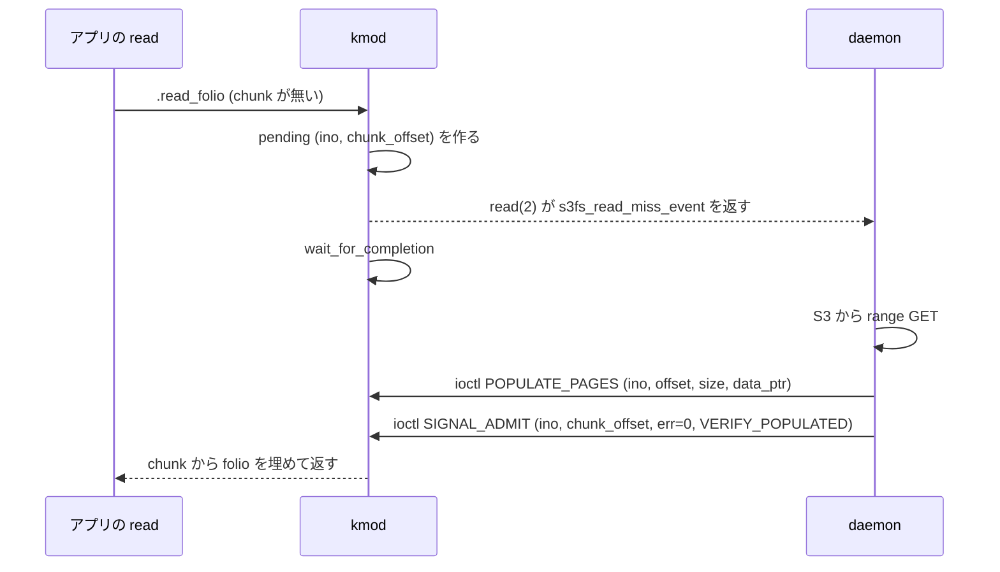

# `/dev/s3fs_ebpf` の通信プロトコル (miss イベントと ioctl)

kmod と daemon は miscdevice `/dev/s3fs_ebpf` でやり取りする。この doc は、そこを流れるメッセージの種類と各フィールドの意味をまとめる。定義の正本は `include/s3fs_ebpf_uapi.h`、kmod 側の受け口は `kmod/s3fs_ebpf_dev.c` の `s3fs_dev_ioctl` / `s3fs_dev_read` / `s3fs_dev_poll`。

**関連 doc**:
- [`component-communication.md`](component-communication.md) — 全通信路 (T1〜T11) の一覧。ここは T7 (ioctl) と T8 (miss の `read(2)`) の詳細
- [`read-path-design.md`](read-path-design.md) — miss から populate までの設計
- [`pcache-mode.md`](pcache-mode.md) — `POPULATE_PAGES` を使う pcache モード

---

## 1. 標準のものか

仕組みは Linux 標準で、メッセージの中身はこのプロジェクト独自。

| 層 | 標準か | 内容 |
|---|---|---|
| デバイス | 標準 | `misc_register` で作る miscdevice (`MISC_DYNAMIC_MINOR`) |
| 通知の受け取り | 標準 | `read(2)` と `poll(2)`。待ち行列は `wait_event_interruptible` / `wake_up_interruptible` |
| コマンド番号 | 標準のマクロで独自に採番 | `_IOW` / `_IOR` / `_IOWR` (`<linux/ioctl.h>`)。magic は `0xE3`、番号は `0x01`〜`0x10` の 16 個 |
| 構造体 | 独自 | `struct s3fs_*`。バージョン交渉はなく、kmod と daemon は同時にビルドし直す前提 (G-01 で `s3fs_sync_entry` のサイズが変わった) |

FUSE の `/dev/fuse` のような汎用プロトコルではない。BPF の ringbuf や USER_RINGBUF を使わない理由は `component-communication.md` §6 と §7。

## 2. 3 つの通り道

| 方向 | 方式 | 使うもの | daemon 側 |
|---|---|---|---|
| kmod → daemon (read の miss) | **`read(2)` でイベントを 1 件ずつ受け取る** (blocking、`O_NONBLOCK` と `poll` 可) | `struct s3fs_read_miss_event` | `runReadMissLoop` (`daemon/cmd/s3fs-ebpf/admit_arena.go`) |
| kmod → daemon (write-back、unlink、rename) | **daemon が ioctl で queue から pop** する。kmod から押す通知はない | `POP_FLUSH` / `POP_FLUSH_WAIT` / `POP_DELETE` / `POP_RENAME` | `flush_loop.go`、`delete_loop.go` |
| daemon → kmod | ioctl で表を置き換える、データを渡す、待っている syscall を起こす | 残りの ioctl | 各ループ |

kmod から daemon への「通知」は、miss だけが `read(2)` によるイベントで、それ以外は daemon が ioctl で取りに行く形になっている。

### 2.1 read の miss (T8)

```c
struct s3fs_read_miss_event {
	__u64 ino;
	__s64 offset; /* miss した位置 */
	__u32 count;  /* 要求バイト数 (U32_MAX で頭打ち) */
	__u32 flags;  /* S3FS_MISS_FLAG_* */
};
```

| flags | 意味 |
|---|---|
| `0` | 普通の read の miss。daemon は取得して populate (pcache) か admit (arena) し、`SIGNAL_ADMIT` で起こす |
| `S3FS_MISS_FLAG_FOR_WRITE` (0x1) | read ではなく変更 (write、truncate) の前の読み込み (AC-50)。daemon は `offset` を含む 4 MiB の chunk を `POPULATE_PAGES` で入れて `SIGNAL_ADMIT` する。arena モードでも arena には入れない |
| `S3FS_MISS_FLAG_PINNED` (0x2) | fd の中身が、固定した ETag のオブジェクトに依存している (dirty、flush 中、remote chunk を持つ)。オブジェクトが変わっていたら衝突として扱う。付いていなければ daemon は古い pin を捨てて Stat し直してよい (AC-51) |

- `read(2)` のバッファが `sizeof(struct s3fs_read_miss_event)` (24 B) より小さいと `-EINVAL`。1 回の `read` で 1 件だけ返す。
- queue は kmod の中のリスト (`s3fs_miss_events`) で、件数の上限はない。
- 待っている側 (kmod の read) は `(ino, chunk_offset)` ごとの pending に `wait_for_completion` で寝ている。同じ chunk を待つ reader は 1 つの completion を共有する。

## 3. ioctl の一覧と付加情報

方向は daemon から見た向き (`→kmod` は daemon が渡す、`←kmod` は kmod から受け取る)。

### 3.1 miss の処理 (read 経路)

| nr | 名前 | 方向 | 構造体 | フィールド | 戻り値 |
|---:|---|---|---|---|---|
| 0x0E | `POPULATE_PAGES` | →kmod | `s3fs_populate_pages` | `ino`、`offset` (データの開始位置)、`size` (バイト数)、`data_ptr` (daemon のバッファ) | pcache モード。kmod は fd の chunk 表にコピーし、`S3FS_ADMIT_FLAG_PCACHE` の admit entry を入れる。以降の read は `generic_file_read_iter` が page cache から返す |
| 0x03 | `SIGNAL_ADMIT` | →kmod | `s3fs_signal_admit` | `ino`、`chunk_offset` (4 MiB 境界、小さいファイルは 0)、`err` (0 = 成功、負の errno は read に返る)、`flags` | 待っている reader がなければ `-ENOENT`。`S3FS_SIGNAL_VERIFY_POPULATED` (0x1) を付けると、chunk が実際に入っているときだけ起こし、なければ `-EAGAIN` (AC-45) |
| 0x02 | `ADMIT_ARENA` | →kmod | `s3fs_admit_arena` + `s3fs_admit_entry[]` | `count` (0 で表を空に)、`entries` (配列へのポインタ)。各 entry は `ino`、`uaddr` (daemon の arena mmap 上の番地)、`size`、`offset` (ファイル上の開始位置。1 つの ino に複数可) | arena モード。表の置き換え。kmod は read のときに `uaddr` を GUP で読む |
| 0x01 | `PROBE_KVBASE` | ↔kmod | `s3fs_probe_kvbase` | in: `arena_fd`。out: `out_kvbase` (arena の kern_vm の先頭)、`out_size` | 起動時の確認用 (Week 4 の spike) |

### 3.2 ディレクトリの内容

| nr | 名前 | 方向 | 構造体 | フィールド | 備考 |
|---:|---|---|---|---|---|
| 0x04 | `SYNC_ENTRIES` | →kmod | `s3fs_sync_entries` + `s3fs_sync_entry[]` | `count` (0 で起動時の表に戻す)、`entries`。各 entry は `ino`、`parent_ino` (0 = root)、`size` (S3 の stat の値)、`mode` (`S_IFREG`/`S_IFDIR` と権限)、`name_len`、`name[256]` (basename) | 表を丸ごと置き換え、古い dentry を落とす。約 30 秒ごとと起動時 |

### 3.3 write-back、unlink、rename (daemon が取りに行く)

| nr | 名前 | 方向 | 構造体 | フィールド | 備考 |
|---:|---|---|---|---|---|
| 0x05 | `POP_FLUSH` | ←kmod | `s3fs_flush_event` | `ino`、`parent_ino`、`size` (enqueue 時のバッファの大きさ)、`name_len`、`name`、`flags` | `.release` / `.fsync` / `.create` が積む。空なら `-EAGAIN`。100 ms ごと |
| 0x0D | `POP_FLUSH_WAIT` | ←kmod | `s3fs_flush_event` | 同上 | blocking 版。`S3FS_FLUSH_FLAG_WAIT` (fsync が待っている) の event だけを返す。シグナルで `-ERESTARTSYS`、unload で `-ENODEV` (S-08) |
| 0x06 | `READ_DIRTY` | ↔kmod | `s3fs_read_dirty` | in: `ino`、`uaddr`、`size` (バッファの容量)。out: `out_bytes` | dirty なバッファを daemon にコピーする |
| 0x0F | `DIRTY_LAYOUT` | ↔kmod | `s3fs_dirty_layout` | in: `ino`、`states_uaddr`、`cap`。out: `nr_chunks`、`size`、`chunk_size`。`states` は chunk ごとに 1 byte で `DATA` (0)、`HOLE` (1)、`REMOTE` (2) | `--partial-modify` の flush。`cap` が足りなければ `-ENOSPC` と `nr_chunks` (AC-51) |
| 0x10 | `READ_DIRTY_RANGE` | ↔kmod | `s3fs_read_dirty_range` | in: `ino`、`uaddr`、`offset`、`size`。out: `out_bytes` | `READ_DIRTY` の offset 指定版。DATA と HOLE の chunk だけ読む (AC-51) |
| 0x0A | `SIGNAL_FLUSH` | →kmod | `s3fs_signal_admit` (流用) | `ino`、`err` (PUT の結果) | 待っている fsync を起こす。待ちがなければ `-ENOENT` (daemon は無視) |
| 0x07 | `MARK_DIRTY` | →kmod | `s3fs_mark_dirty` | `ino` | PUT に失敗したとき dirty に戻し、次の close / fsync で積み直させる |
| 0x0B | `POP_DELETE` | ←kmod | `s3fs_delete_event` | `ino`、`parent_ino`、`name_len`、`name` | `.unlink` が積む。daemon は S3 の DELETE。空なら `-EAGAIN` |
| 0x0C | `POP_RENAME` | ←kmod | `s3fs_rename_event` | `ino`、`old_parent_ino`、`new_parent_ino`、`old_name_len`、`new_name_len`、`old_name`、`new_name` | `.rename` が積む。daemon は CopyObject + Delete。空なら `-EAGAIN` |

### 3.4 統計と eviction

| nr | 名前 | 方向 | 構造体 | フィールド | 備考 |
|---:|---|---|---|---|---|
| 0x08 | `STATS` | ↔kmod | `s3fs_stats` | in: `count` (確保した slot 数、最大 16)。out: `filled`、`values[]`。slot は [0] evictions_total、[1] folio_hits、[2] admit_invalidations。番号は足すだけで振り直さない | 5 秒ごと |
| 0x09 | `DRAIN_EVICTIONS` | ↔kmod | `s3fs_drain_evictions` | in: `cap`。out: `filled`、`overflow` (queue があふれて捨てた件数)、`inos[256]` | policy が追い出した ino を受け取る。`overflow` が 0 でなければ daemon は表を丸ごと合わせ直す。2 秒ごと |

## 4. miss 1 回の流れ (pcache モード)



## 5. 変えるとき

- 構造体のサイズを変えたら kmod と daemon を同時にビルドし直す。交渉の仕組みはない。
- ioctl を足すときは、`include/s3fs_ebpf_uapi.h`、`kmod/s3fs_ebpf_dev.c` の switch、この doc の §3、`component-communication.md` の §1.1 を同じ変更で直す。
