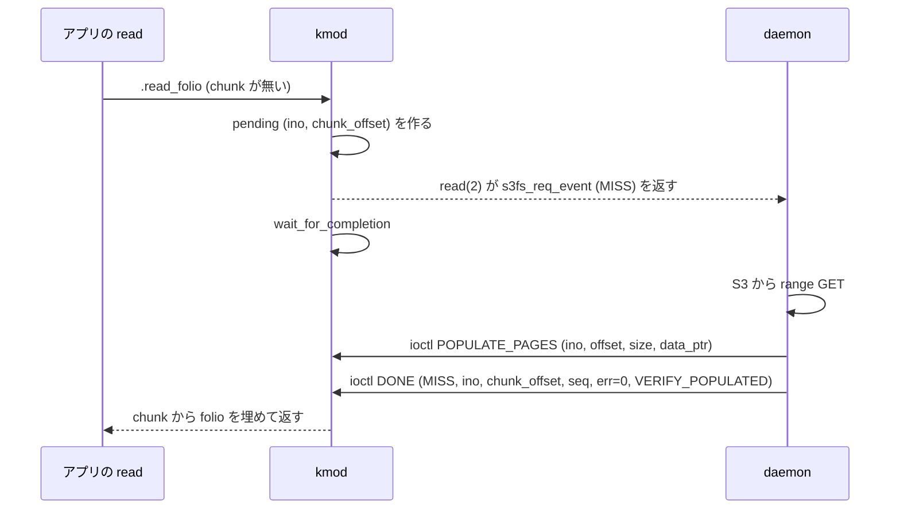

# `/dev/s3fs_ebpf` の通信プロトコル (miss イベントと ioctl)

kmod と daemon は miscdevice `/dev/s3fs_ebpf` でやり取りする。この doc は、そこを流れるメッセージの種類と各フィールドの意味をまとめる。定義の正本は `include/s3fs_ebpf_uapi.h`、kmod 側の受け口は `kmod/s3fs_ebpf_dev.c` の `s3fs_dev_ioctl` / `s3fs_dev_read` / `s3fs_dev_poll`。

**関連 doc**:
- [`daemon-kmod-messaging.md`](daemon-kmod-messaging.md) — イベント (miss / flush / fsync / unlink / rename / sync / evict) ごとの図と、kmod の中のキューの構造。この doc は構造体の定義、あちらはイベントの流れ
- [`component-communication.md`](component-communication.md) — 全通信路 (T1〜T11) の一覧。ここは T7 (ioctl) と T8 (miss の `read(2)`) の詳細
- [`read-path-design.md`](read-path-design.md) — miss から populate までの設計
- [`pcache-mode.md`](pcache-mode.md) — `POPULATE_PAGES` を使う pcache モード

---

## 1. 標準のものか

仕組みは Linux 標準で、メッセージの中身はこのプロジェクト独自。

| 層 | 標準か | 内容 |
|---|---|---|
| デバイス | 標準 | `misc_register` で作る miscdevice (`MISC_DYNAMIC_MINOR`) |
| 通知の受け取り | 標準 | `read(2)` と `poll(2)`。待ち行列は `wait_event_interruptible` / `wake_up_interruptible` |
| コマンド番号 | 標準のマクロで独自に採番 | `_IOW` / `_IOR` / `_IOWR` (`<linux/ioctl.h>`)。magic は `0xE3`、番号は `0x01`〜`0x10` の 16 個 |
| 構造体 | 独自 | `struct s3fs_*`。バージョン交渉はなく、kmod と daemon は同時にビルドし直す前提 (G-01 で `s3fs_sync_entry` のサイズが変わった) |

FUSE の `/dev/fuse` のような汎用プロトコルではない。BPF の ringbuf や USER_RINGBUF を使わない理由は `component-communication.md` §6 と §7。

## 2. 2 つの通り道 (v2 Phase 4)

| 方向 | 方式 | 使うもの | daemon 側 |
|---|---|---|---|
| kmod → daemon (miss、write-back、unlink、rename) | **`read(2)` で要求を 1 件ずつ受け取る** (blocking、`O_NONBLOCK` と `poll` 可)。kmod 内は 1 本の FIFO (`reqq`) で、積まれた順に返る | `struct s3fs_req_event` (592 B) | `runReqLoop` (`daemon/cmd/s3fs-ebpf/reqloop.go`): MISS は worker、FLUSH / DELETE / RENAME は executor (`event_order.go`) |
| daemon → kmod | ioctl で表を置き換える、データを渡す、待っている syscall を起こす | 残りの ioctl | 各ハンドラ |

以前は miss だけが `read(2)` で、write-back・unlink・rename は daemon が ioctl の `POP_*` で取りに行っていた (5 本のキュー)。いまは全部が `read(2)` 1 本で、kmod が積んだ時点で daemon が起きる (100 ms の ticker はない)。

### 2.1 要求 (`struct s3fs_req_event`)

```c
struct s3fs_req_event {
	__u32 type;            /* S3FS_REQ_MISS 1 / FLUSH 2 / DELETE 3 / RENAME 4 */
	__u32 flags;           /* MISS: S3FS_MISS_FLAG_*、FLUSH: S3FS_FLUSH_FLAG_WAIT */
	__u64 seq;             /* FLUSH / DELETE / RENAME の通し番号 (AC-84)。MISS は 0 */
	__u64 ino;
	__u64 parent_ino;      /* RENAME は旧の親 */
	__u64 new_parent_ino;  /* RENAME */
	__u64 size;            /* FLUSH: 積んだ時のバッファの大きさ */
	__s64 offset;          /* MISS: miss した位置 */
	__u32 count;           /* MISS: 要求バイト数 (U32_MAX で頭打ち) */
	__u32 seq_count, rand_count; /* MISS: read pattern */
	__u32 name_len, new_name_len, _pad;
	char  name[256], new_name[256];  /* FLUSH / DELETE: basename、RENAME: 旧 / 新 */
};
```

| type | 起こす操作 | 待つか | daemon の処理 |
|---|---|---|---|
| MISS | `.read_folio` / `.open` (`open_check`) / write の前の読み込み | 同期 (`DONE` まで) | S3 から取って `POPULATE_PAGES`、`DONE` (MISS) |
| FLUSH | `.release` / `.create` (非同期)、`.fsync` (flags に `WAIT`、`DONE` まで同期) | WAIT のみ | READ_DIRTY して PUT。WAIT は即時、それ以外は 200 ms の debounce (coalescer) |
| DELETE | `.unlink` | 非同期 | S3 の DELETE |
| RENAME | `.rename` | 非同期 | CopyObject + DELETE |

読んだ順が積んだ順なので、daemon は FLUSH / DELETE / RENAME を **読んだ順に 1 件ずつ**処理する (rename が直前に作ったファイルの flush を追い越さない、AC-84)。fsync の WAIT flush も同じ FIFO にいるので、その前に積まれたイベントは PUT の前に処理済みになる。

### 2.2 MISS の flags

| flags | 意味 |
|---|---|
| `0` | 普通の read の miss。daemon は取得して populate (pcache) か admit (arena) し、`DONE` で起こす |
| `S3FS_MISS_FLAG_FOR_WRITE` (0x1) | read ではなく変更 (write、truncate) の前の読み込み (AC-50)。daemon は `offset` を含む 4 MiB の chunk を `POPULATE_PAGES` で入れて `DONE` する。arena モードでも arena には入れない |
| `S3FS_MISS_FLAG_OPEN_CHECK` (0x4) | read ではなく、`open(2)` (O_CREAT なし) が S3 に存在を確かめる要求。kmod の module param `open_check=1` (既定) のときだけ送る (既定 1)。daemon は HEAD して `DONE` の `err` に 0 / `-ENOENT` (404) / `-EIO` を入れる。何も populate しない。pending の `chunk_offset` は all ones (`S3FS_OPEN_CHECK_KEY`) |
| `S3FS_MISS_FLAG_PINNED` (0x2) | fd の中身が、固定した ETag のオブジェクトに依存している (dirty、flush 中、remote chunk を持つ)。オブジェクトが変わっていたら衝突として扱う。付いていなければ daemon は古い pin を捨てて Stat し直してよい (AC-51) |

- `read(2)` のバッファが `sizeof(struct s3fs_req_event)` (592 B) より小さいと `-EINVAL`。1 回の `read` で 1 件だけ返す。
- `FOR_WRITE` / `PINNED` / `OPEN_CHECK` は排他ではなく、`flags` の bit。`PINNED` は元の event に付く修飾。
- queue は kmod の中のリスト (`s3fs_reqq`) で、件数の上限はない。
- 待っている側 (kmod の read) は `(ino, chunk_offset)` ごとの pending に `wait_for_completion` で寝ている。同じ chunk を待つ reader は 1 つの completion を共有する。

## 3. ioctl の一覧と付加情報

方向は daemon から見た向き (`→kmod` は daemon が渡す、`←kmod` は kmod から受け取る)。

### 3.1 miss の処理 (read 経路)

| nr | 名前 | 方向 | 構造体 | フィールド | 戻り値 |
|---:|---|---|---|---|---|
| 0x02 | `EVAL` | →kmod | (なし) | kmod の容量 / policy パスを今走らせる。旧 `ADMIT_ARENA` (arena の範囲の登録) の nr を引き継いだ。デバイスを open すると upcall が有効になる | 0 |
| 0x0E | `POPULATE_PAGES` | →kmod | `s3fs_populate_pages` | `ino`、`offset` (データの開始位置)、`size` (バイト数)、`data_ptr` (daemon のバッファ) | pcache モード。kmod は fd の chunk 表にコピーし、`S3FS_ADMIT_FLAG_PCACHE` の admit entry を入れる。以降の read は `generic_file_read_iter` が page cache から返す |
| 0x12 | `DONE` | →kmod | `s3fs_done` (40 B) | `type` (`S3FS_REQ_MISS` / `FLUSH`)、`flags` (`S3FS_DONE_VERIFY_POPULATED`)、`ino`、`chunk_offset`、`seq`、`err` | daemon が request を終えた知らせ。**MISS**: `(ino, chunk_offset)` の record の待ち手を起こす。`seq` が request の seq なら**その record だけ** (別の seq は `-ENOENT`)、0 なら普通の read の record (chunk load が自分の request ではない chunk を key で知らせる)。`err == 0` + `VERIFY_POPULATED` で、chunk が populated でなければ起こさず `-EAGAIN` (AC-45)。**FLUSH**: PUT が終わった。`err == 0` で、PUT の read が最新の flush request を覆っていれば (W3) flushing を下ろして fsync を起こす。`err < 0` は kmod が dirty を戻して (旧 `MARK_DIRTY`)、flushing を下ろし、fsync に err を返す。ino 単位 (daemon の debounce が複数の close を 1 回の PUT にまとめるため)。旧 `SIGNAL_ADMIT` (0x03)・`SIGNAL_FLUSH` (0x0A)・`MARK_DIRTY` (0x07) の置き換え (番号は再利用しない) |

### 3.2 ディレクトリの内容

| nr | 名前 | 方向 | 構造体 | フィールド | 備考 |
|---:|---|---|---|---|---|
| 0x04 | `SYNC_ENTRIES` | →kmod | `s3fs_sync_entries` + `s3fs_sync_entry[]` | `count` (0 で起動時の表に戻す)、`entries`。各 entry は `ino`、`parent_ino` (0 = root)、`size` (S3 の stat の値)、`mode` (`S_IFREG`/`S_IFDIR` と権限)、`name_len`、`name[256]` (basename) | 表を丸ごと置き換え、古い dentry を落とす。約 30 秒ごとと起動時 |

### 3.3 write-back、unlink、rename (daemon が取りに行く)

| nr | 名前 | 方向 | 構造体 | フィールド | 備考 |
|---:|---|---|---|---|---|
| 0x06 | `READ_DIRTY` | ↔kmod | `s3fs_read_dirty` | in: `ino`、`uaddr`、`size` (バッファの容量)。out: `out_bytes` | dirty なバッファを daemon にコピーする |
| 0x0F | `DIRTY_LAYOUT` | ↔kmod | `s3fs_dirty_layout` | in: `ino`、`states_uaddr`、`cap`。out: `nr_chunks`、`size`、`chunk_size`。`states` は chunk ごとに 1 byte で `DATA` (0)、`HOLE` (1)、`REMOTE` (2) | `--partial-modify` の flush。`cap` が足りなければ `-ENOSPC` と `nr_chunks` (AC-51) |
| 0x10 | `READ_DIRTY_RANGE` | ↔kmod | `s3fs_read_dirty_range` | in: `ino`、`uaddr`、`offset`、`size`。out: `out_bytes` | `READ_DIRTY` の offset 指定版。DATA と HOLE の chunk だけ読む (AC-51) |

### 3.4 統計と eviction

| nr | 名前 | 方向 | 構造体 | フィールド | 備考 |
|---:|---|---|---|---|---|
| 0x08 | `STATS` | ↔kmod | `s3fs_stats` | in: `count` (確保した slot 数、最大 16)。out: `filled`、`values[]`。slot は [0] evictions_total、[1] folio_hits、[2] admit_invalidations。番号は足すだけで振り直さない | 5 秒ごと |

## 4. miss 1 回の流れ (pcache モード)



## 5. 変えるとき

- 構造体のサイズを変えたら kmod と daemon を同時にビルドし直す。交渉の仕組みはない。
- ioctl を足すときは、`include/s3fs_ebpf_uapi.h`、`kmod/s3fs_ebpf_dev.c` の switch、この doc の §3、`component-communication.md` の §1.1 を同じ変更で直す。
