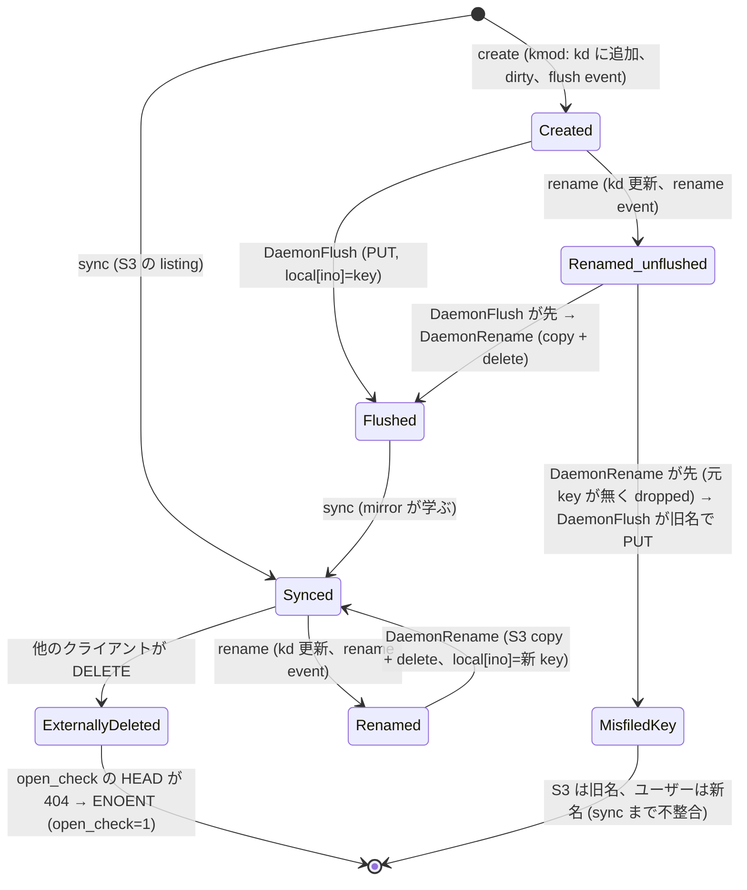

# ファイルの状態遷移 (kmod / daemon / S3) と、形式検証で見つけたこと

2026-11-05。PR #44 の `open_check` の作業で「open が S3 を確認していなかった」「作成直後のファイルを開き直すと ENOENT」を、実装と測定のあとで見つけた。同じ種類の見落としを設計の段階で見つけるために、ファイルの状態遷移を図にして、TLA+ で検証した。モデルは `specs/tla/FileLifecycle.tla`、実行は `make test-spec`。手順は `docs/dev-notes/design-verification.md`。

## 1. 誰がどの状態を持っているか

| 持ち主 | 状態 | 更新するもの |
|---|---|---|
| kmod | `kd`: name → ino (ユーザーに見える名前の表)、fd の dirty / flushing | create / rename / unlink (同期)、sync (置換) |
| daemon | `mirror`: ino → S3 key (`fpebpf` の entry)。`local`: ino → key (`localKeys`、open_check 用) | sync が `mirror` を置換。flush / rename は `local` だけ更新 (PR #44 時点) |
| S3 | key → 内容 | flush の PUT、rename の copy + delete (どちらも daemon の別々のループ) |

kmod → daemon の通知は 2 本の独立した ticker ループ (flush: 100 ms ticker + 200 ms debounce、rename / delete: 別の ticker) で、**発生順が保たれない**。

## 2. ファイルの状態遷移

Flushed の間、`mirror` はこの ino を知らない (`local` だけが知る)。read miss は `mirror` だけを引くので、**Flushed で kmod が chunk を捨てた後の read は解決できない** (sync まで)。

## 3. 検証したこと (TLA+、TLC)

モデル: 名前 3 つ、inode 2 つ、イベントのキュー長 ≤ 3 (確認として 5)。内容は「どの ino のバイト列か」だけを持つ。

| 性質 | 意味 |
|---|---|
| `OpenOK` | ユーザーに見えていて、バイト列が S3 のどこかにあるファイルは、`open_check` が引く key (`local` → `mirror`) で見つかる |
| `ReadOK` | 同じファイルは、read miss が引く key (`mirror` だけ) で見つかる |
| `QuiescentConsistent` | daemon に残りの仕事がないとき、S3 の key はユーザーが付けた名前と一致する |

変種: `RecordKeys` (flush / rename が `mirror` も更新する、AC-82 の修正案)、`Serialized` (flush と rename を kmod が積んだ順に処理する)。

| 変種 | OpenOK | ReadOK | QuiescentConsistent |
|---|---|---|---|
| base (PR #44 時点の実装) | 違反 | 違反 | 違反 |
| keys (`RecordKeys`) | 違反 | 違反 | 違反 |
| serialized (`Serialized`) | 違反 | 違反 | 違反 |
| **keys-serialized (両方)** | **満たす (316 状態、キュー長 5 でも 1788 状態)** | **満たす** | **満たす** |

反例 (最短):
1. **mirror が作成を学ばない** (`ReadOK`、3 状態): `Create("b")` → `DaemonFlush`。flush した ino は `local` にあるが `mirror` にない。→ `RecordKeys` で直る。
2. **作成直後の rename で S3 の key が旧名になる** (`QuiescentConsistent`、5 状態): `Create("b")` → `Rename("b","c")` → `DaemonRename` (元 key が S3 にないので dropped) → `DaemonFlush` (旧名 b に PUT)。→ `Serialized` で直る。**実機で再現した** (`test-parity` の `create_rename_quick`: s3fs-fuse は `q2.txt`、s3fs-ebpf は `q1.txt`)。
3. **rename の直後に同じ名前で作ると、内容が入れ替わる** (`OpenOK`、5 状態): `Rename("a","b")` → `Create("a")` → `DaemonFlush` (旧 ino の object `a` を上書き) → `DaemonRename` (新しい内容を `b` に移して `a` を消す)。ino ごとの順序づけでは防げない (ino が違う)。→ `Serialized` で直る。**実機では再現しなかった**: 別のバグ (rename 直後の旧名での作成が EEXIST、kmod が旧名を空けていない) が覆い隠している (`rename_then_reuse_name`)。その EEXIST を直すと、このデータ損失が表に出る。

## 4. 実装との対応と、モデルの限界

| モデルの操作 | コード |
|---|---|
| `Create` | kmod `.create` → flush event (`flush_queue.inc.c`) |
| `Rename` | kmod `.rename` → rename event (`delete_rename_queue.inc.c`) |
| `DaemonFlush` | `handleFlush` (`flush_loop.go`)、key は `resolveEventS3Key` (mirror → event の名前) |
| `DaemonRename` | `handleRename` (`delete_loop.go`)、`s3c.Rename` は copy + delete |
| `Sync` | `syncEntriesOnce` (`sync_entries.go`) |
| `OpenKey` / `ReadKey` | `openCheckKeyFor` (`readmiss.go`) / `handleReadMiss` の `LookupByIno` |

含めていない: fsync の WAIT 経路 (即時 PUT)、dirty / flushing の fd、外部クライアントの更新、unlink、タイミング (ticker の間隔)、複数ファイルの同時 rename。**モデルが通っても実装が正しいとは言えない**。反例は実機で確かめ (反例 2 は再現、3 は別のバグに隠れた)、修正は実装の回帰試験 (`make test-parity`) でも確かめる。

## 5. 起票

- AC-82: rename 後の open が EIO / 作成した ino を mirror が学ばない (反例 1 を追記)。
- AC-84: flush と rename の処理順が保証されない (反例 2、3)。
- AC-85: rename 直後の旧名での作成が EEXIST。
