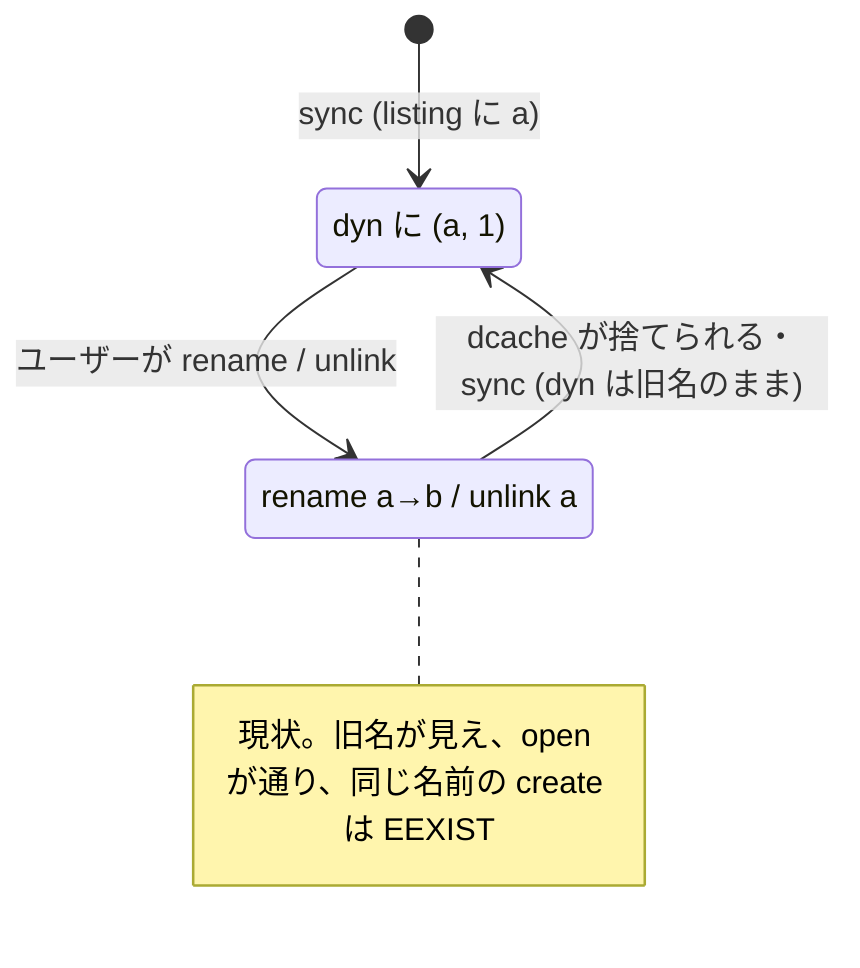
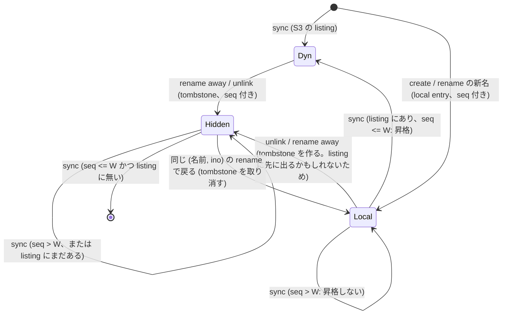

# kmod の entry 表 (local / dyn / tombstone) の状態遷移と、AC-85 の設計

2026-11-05。`docs/design/file-lifecycle-state-machine.md` の続き。AC-84 / AC-86 を直すと、S3 由来の entry (dyn) が rename / unlink の後も旧名で見え続ける問題 (AC-85) が露出した。モデルは `specs/tla/KmodEntries.tla`、実行は `make test-spec`。

## 1. 現状 (AC-84 まで)

| 表 | 中身 | 更新するもの |
|---|---|---|
| `local` (`s3fs_local_entries`) | kmod 自身が作った entry (create) | create が追加、rename が名前を書き換え、unlink が削除、sync が「listing に同じ (名前, ino) がある」ものを昇格 (削除) |
| `dyn` (`s3fs_dyn_entries`) | 直近の S3 listing (daemon の sync が丸ごと置換) | sync だけ |

lookup は local → dyn の順に引く。**rename / unlink は dyn を更新できない**ので、S3 由来のファイルは旧名のまま見える。普段は VFS の dcache (rename 後の旧名は負の dentry) が隠しているが、sync で listing が変わると `shrink_dcache_sb` が負の dentry も捨てるため、次の lookup で旧名が復活する。

## 2. 設計: tombstone と「適用済み」の目印

rename / unlink した entry の (親, 名前, ino) を **tombstone** として覚え、lookup と readdir の dyn の結果から外す。rename の新しい名前は local entry にする (S3 由来のファイルの rename でも)。

モデルで見つかった、tombstone の消し方・local entry の昇格の条件 (どれも欠くと反例が出る):

| 規則 | 欠くと (反例) |
|---|---|
| sync で全部消さない | unlink → sync → 旧名が復活 (`always`) |
| listing に無くなっただけでは消さない | create (flush 済み、delete は未適用) → unlink → sync で listing に出る → 復活 (`absent`) |
| 消すのは「daemon がその操作を S3 に適用済み」かつ「listing に無い」とき | — (`tombstone`) |
| local entry の昇格も「適用済み」を要求する | mv a b; mv b a → 古い listing に (a,1) があるので昇格 → daemon が途中の状態 b を反映した次の sync で a が消える (`applied-listed`) |
| local entry を (名前, ino) で作り直したら、同じ (名前, ino) の tombstone を取り消す | mv a c; mv c a で a が隠れる |

「適用済み」は、kmod のイベントの通し番号 (AC-84 の `seq`) で表す。local entry と tombstone は、それを作った操作のイベントの `seq` を持つ。daemon は sync の前に**適用済みの番号 W** (W 以下のイベントは全部 S3 に反映済み) を測って kmod に渡し、kmod は `seq <= W` のときだけ消す・昇格する。W より後に S3 を listing するので、listing は W までの操作を含む。

## 3. 検証 (TLA+)

名前 3 つ、inode 2 つ、キュー長 ≤ 3 (確認として 4: 53301 状態)。性質 `Consistent`: lookup の結果が、ユーザーが期待する名前 → ino の対応と常に一致する。`QuiescentConsistent`: daemon の仕事が尽きたとき S3 がユーザーの期待と一致する (見えている名前を信じて操作するので、見え方の誤りは S3 の誤りになる)。

| 変種 | Consistent | QuiescentConsistent | 最短の反例 |
|---|---|---|---|
| base (AC-84 まで) | 違反 | 違反 | `Create` `Unlink(a)` |
| always (sync で全部消す) | 違反 | 違反 | `Unlink` `Sync` |
| absent (listing に無ければ消す) | 違反 | 違反 | create → unlink → flush だけ適用 → `Sync` |
| applied-listed (昇格は即時) | 違反 | 違反 | `Rename(a,b)` `Rename(b,a)` `Sync` `Daemon` `Sync` |
| **tombstone (両方「適用済み」)** | **満たす (24357 状態)** | **満たす** | — |

**限界**: 1 つのディレクトリ、同名の上書き rename (`RENAME_NOREPLACE` 以外) は含まない。dcache はモデル化していない (dcache は旧名の復活を一時的に隠すだけ)。

## 4. 実装との対応

| モデル | 実装 |
|---|---|
| `local` の `k` | `s3fs_local_entry.seq` (`.create` の flush event、`.rename` の rename event の `seq`) |
| `tomb` | `s3fs_hidden_entries` (`kmod/vfs/entries.inc.c`)、`entries_mtx` の下 |
| `Rename` / `Unlink` | `entry_rename` / `entry_forget` (`kmod/vfs/dir_super_ops.inc.c`) |
| `Sync` | `s3fs_ebpf_entries_replace(entries, count, applied_seq)`、ioctl `S3FS_IOC_SYNC_ENTRIES` の `applied_seq` |
| daemon の「適用済み」 | `appliedSeqFor()` (`event_order.go`): kmod の現在のイベント番号 C (`S3FS_IOC_STATS` slot 15) まで処理して、PUT 前の flush の最小 seq - 1 で止めた値。daemon が再起動しても C は続く (`appliedSeq()` は device なしの保守的な形) |
| `View` | `resolve_entry_by_name` (hidden を飛ばす)、`emit_one_entry` (readdir) |
