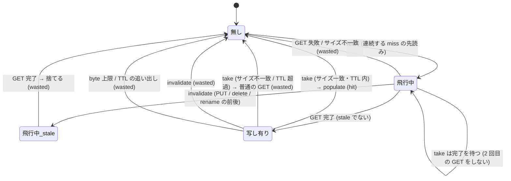

# Object staging: 小さいファイルの先読み (AC-88)

小さいファイルを大量に cold read する (`cat dir/*`) と、1 ファイルごとに「miss → upcall → S3 GET → populate → 読み手が次を open」が直列に並ぶ。ハンドラの 1 ファイルあたり約 820 µs のうち **S3 GET が約 728 µs (89%)** で、lookup は 0 µs、populate は 15 µs (§18.57)。読み手が次に開くファイルは前の読みの後でしか決まらないので、GET を重ねる場所がなかった。

`dir` を名前順に読んでいる (連続した miss が名前順の次の file) と分かったら、daemon が次の `depth` 個を先に並列で GET して**メモリ (staging)** に置く。次の miss は GET せず、staging から populate する。kmod の変更はない。

## 状態と更新者

| 状態 | 持ち主 | 更新するもの (経路が複数のものに ※) |
|---|---|---|
| S3 の object (version) | S3 | flush の PUT / PutWithCopy (`handleFlushWith`) ※、delete (`handleDelete`)、rename (`handleRename`)、**外部のクライアント** (daemon に通知がない) |
| kmod の chunk 表 (clean な写し) | kmod | miss の populate、evict (capacity pass、nocache)、write |
| staging の写し (key → bytes) | daemon `stager` | prefetch の完了 (`fetch`)、miss の消費 (`take`)、無効化 (`invalidate`)、byte 上限・TTL の追い出し (`trimLocked`) |
| 飛行中の GET (key → flight) | daemon `stager` | `fetch` (登録)、完了 (削除)、`invalidate` (stale の印) |
| 予測の状態 (directory ごとの last / run / fetchedTo) | daemon `stager` | `observe` (miss のたびに) |

## 状態遷移図 (1 つの key の写し)

どの状態からも `invalidate` の矢印がある。`飛行中` で止まったまま (`stale` の印がない) PUT が済むと古い写しが `写し有り` に入るので、`飛行中_stale` を作った (下のモデルの反例)。

## TLA+ モデル (`specs/tla/ObjStaging.tla`)

1 つの key。性質 `Fresh`: clean な miss の後、kmod が持つのは S3 が持つ version。変数は s3 / flushing / chunk / stage / gen / infl (飛行中の GET: 発行時の gen と、S3 が返した version)。変種は 3 つの定数。

| 変種 | InvalStart | InvalDone | GenCheck | 結果 | 反例の読み |
|---|---|---|---|---|---|
| base | – | – | – | **violated** | 何も無効化しない: 先読み → write → PUT → evict → miss で古い写しを返す |
| done-nogen | – | ○ | – | **violated** | PUT 後に無効化しても、PUT の前に S3 が返した GET が PUT の後に完了して写しになる |
| start | ○ | – | ○ | **violated** | PUT の開始時だけ無効化: PUT 中に発行した GET は古い version を返し、gen が変わらないので写しになる |
| **done** | – | ○ | ○ | ok | |
| **both** | ○ | ○ | ○ | ok | 実装 (前後の両方で無効化。start は無害) |

→ 設計の根拠: **PUT の完了の後に無効化する** + **無効化をまたいだ GET の結果は捨てる**。実装は前後の両方 (`both`)。

## モデルの操作とコードの対応

| モデル | コード |
|---|---|
| `Write` / `PutDone` | `handleFlushWith` (`flush_loop.go`、PUT と partial の PutWithCopy の両方を含む)、`handleDelete` / `handleRename` (`delete_loop.go`): `stagingInvalidate(key)` を最初と、defer で最後に呼ぶ |
| `Evict` | kmod (capacity pass、nocache の open での reset) |
| `PrefetchIssue` / `PrefetchServe` / `PrefetchDone` | `stager.fetch` (flight 登録 → `s3c.Get` → ロックの下で `flight.stale` を見て保存) |
| `GenCheck` | `flight.stale` (`invalidate` が立てる) |
| `Miss` | `handleReadMiss` の small 経路: `staging.take` → なければ `s3c.Get` |

## 実装の要点と上限

- **対象**: 小さい (<= `maxObj` 1 MiB) 通常ファイルの miss。大きいファイルは chunk の経路 (read-ahead は AC-89)。
- **予測** (`observe`): directory ごとに、名前順 (`Entry.Name` の byte 順、`cat *` の glob と同じ順 (C ロケール)) の次の file が連続して 2 回来たら、後ろの `depth` 個 (既定 16) を並列 GET (`workers` 8)。窓は miss のたびに 1 つずつ進む。
- **自己調整**: 256 件の fetch のうち使われたのが 25% 未満なら 10 秒止める (別の順で読む directory で GET を無駄にしない)。
- **メモリ**: 既定 64 MiB (`--staging-bytes`、0 で off)。古いものから追い出す。TTL 5 秒。表が 50 万件を超えると index を作らず off。
- **サイズの一致**: miss の entry の `Fallback` と写しの長さが違えば使わない (listing より新しい / 古い object の取り違えを避ける)。
- **外部の更新**: daemon に通知が来ない更新は **TTL 5 秒の間は古い写しを返しうる**。普通の miss も、sync までの間の外部更新を見ない (見える範囲は同じ程度)。厳密さが要るなら `--staging-bytes=0`。
- **metrics**: `s3fs_ebpf_staging_{fetches,hits,wasted}_total`。

## 検証

- `make test-spec`: `ObjStaging.*` の 5 変種が cfg の期待どおり。
- `make test-staging` (実機): 名前順の cat で hit (>= 30)、staged の file を同じ長さで書き換えて fsync → 次の miss で新しい中身 (無効化を外すと FAIL することを確認した)、delete / rename、ランダムな順。
- `go test -race ./cmd/...`: take / 飛行中の待ち / 無効化をまたぐ GET / byte 上限・TTL / 予測 (連続・ランダム・自己調整)。
- 性能: `benchmark-results.md` §18.57。
