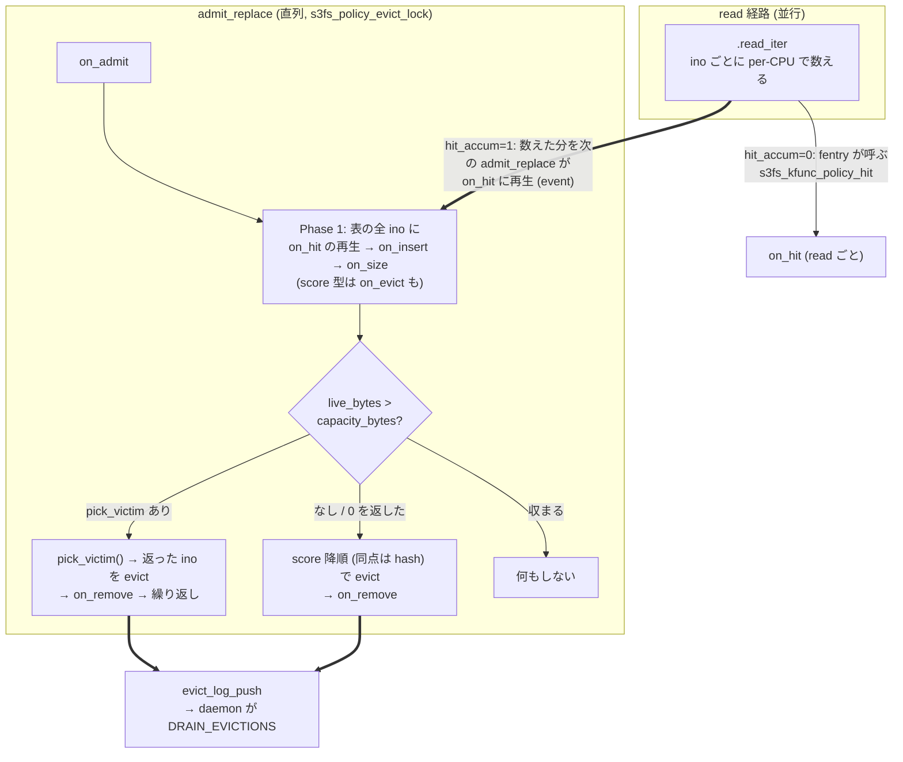
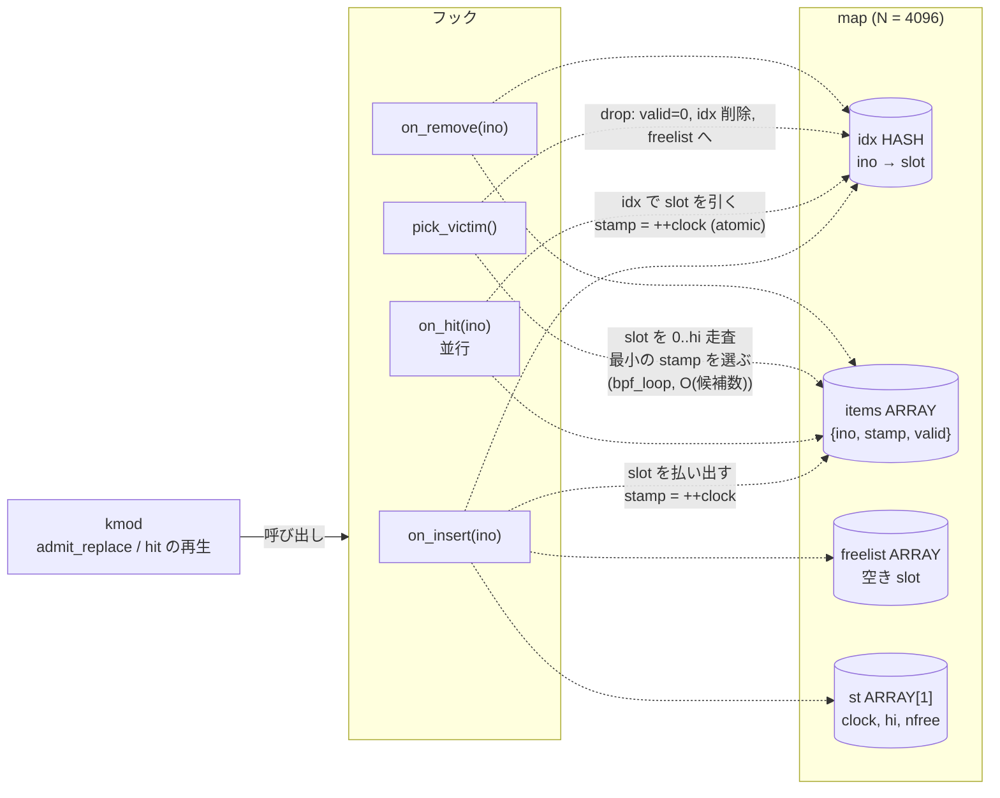
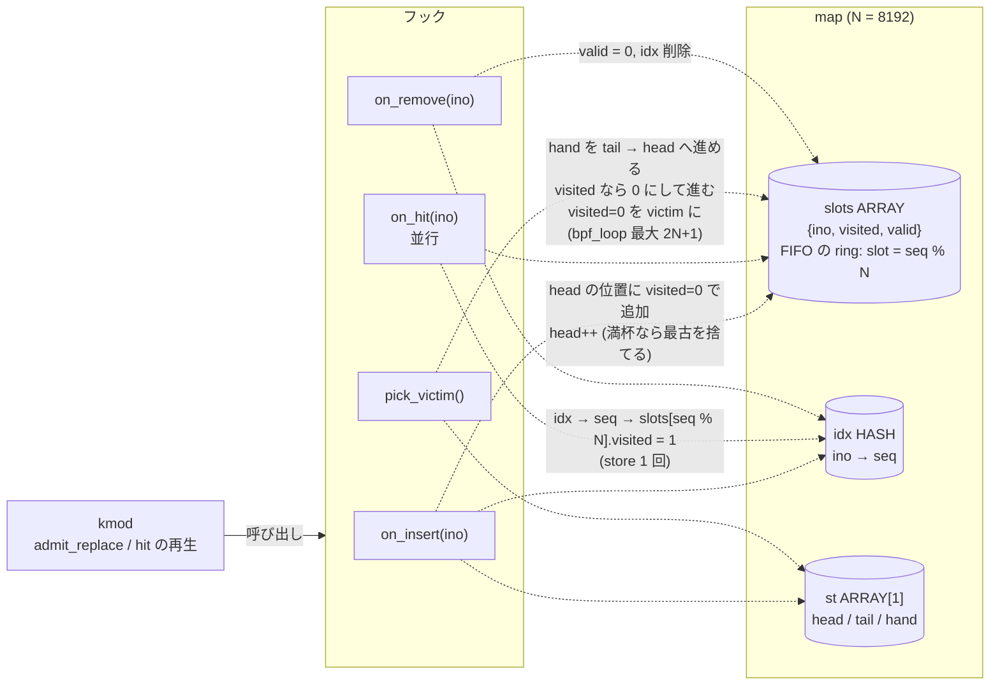
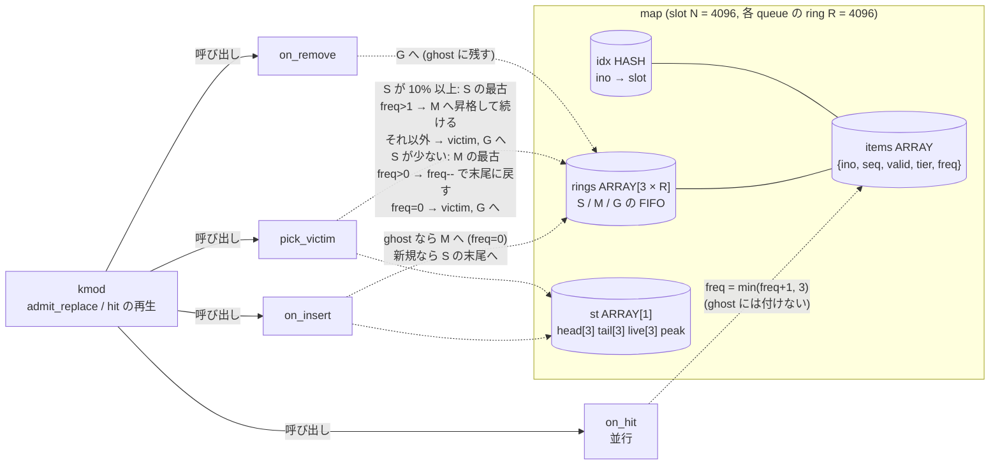
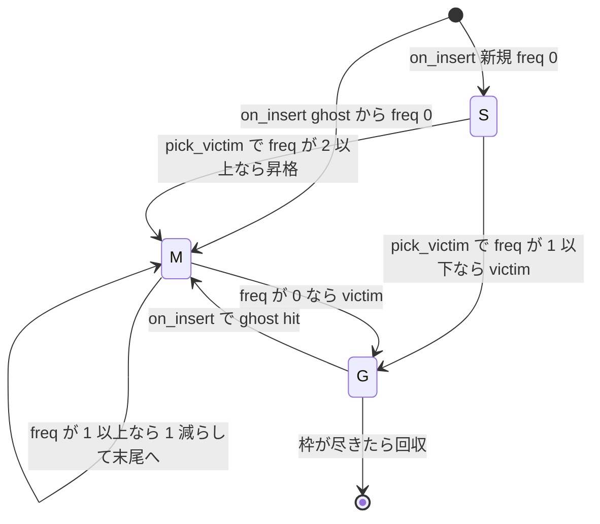
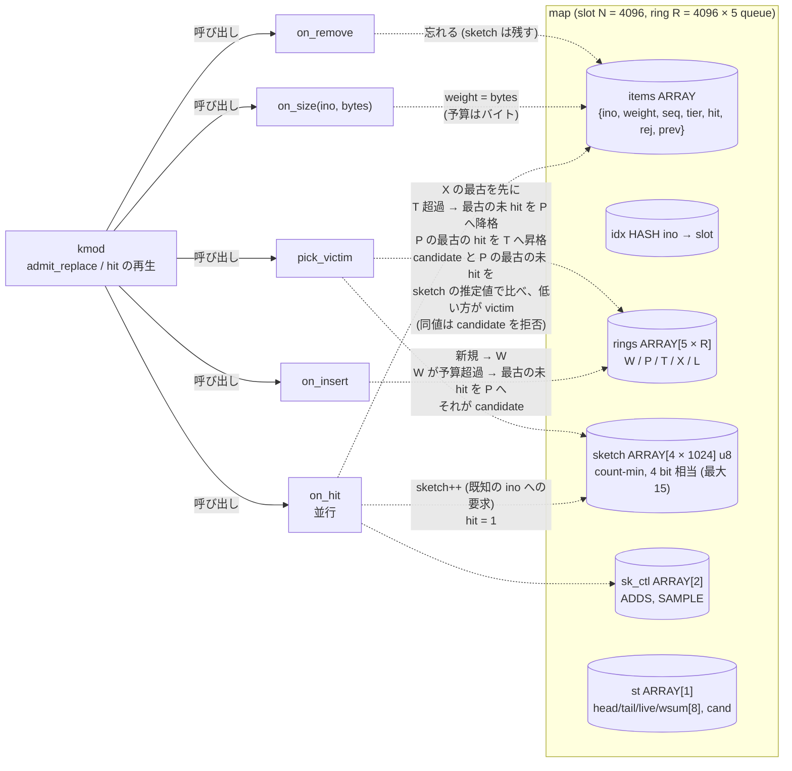
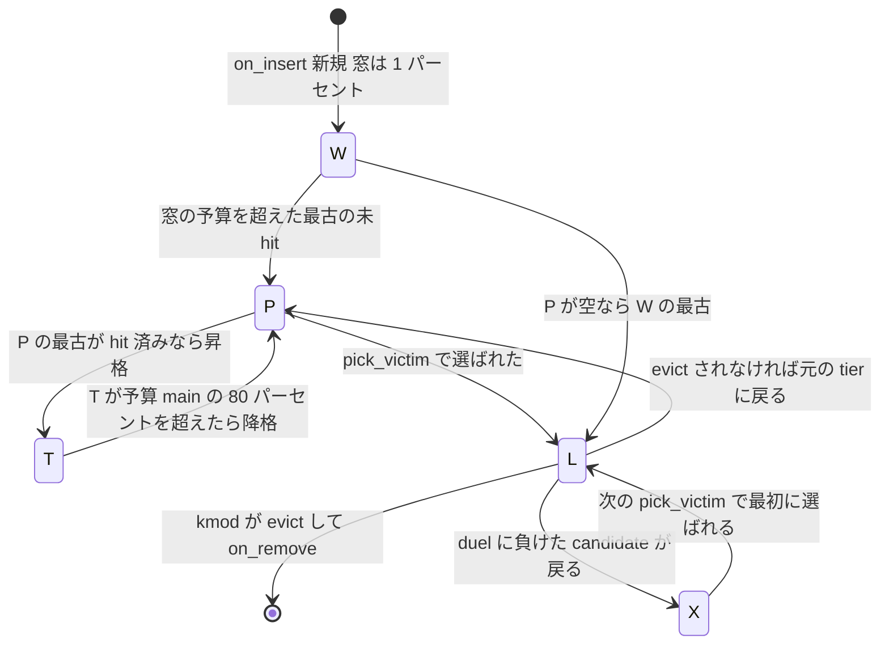
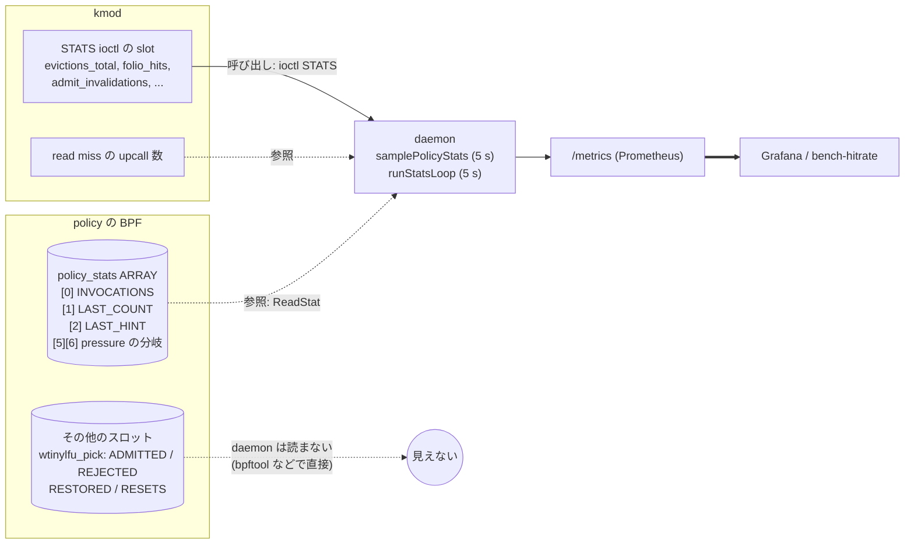

# キャッシュアルゴリズムごとの BPF map の使い方: フック・指標との対応

2026-11-05。キャッシュの追い出しを決める policy (`bpf/policy_*_ops.bpf.c`) が、**どのフックで、どの BPF map を、どう読み書きするか**を、アルゴリズムごとに図で示す。あわせて、そのフックが kmod のどこから呼ばれるか、結果がどの指標に現れるかを対応させる。アルゴリズム自体の説明は [`cache-algorithms.md`](cache-algorithms.md)、vtable の設計は [`ac58-pick-victim.md`](ac58-pick-victim.md) と [`policy-engine-design.md`](policy-engine-design.md)、W-TinyLFU の計画は [`wtinylfu-pick-plan.md`](wtinylfu-pick-plan.md)。ここは「map の中身」と「フック・指標との結び目」に絞る。

---

## 1. フックと呼び出し元

policy は 1 つの struct_ops (`struct s3fs_policy_ops`、`kmod/policy_struct_ops.h`) として kmod に差し込まれる。BPF のフックは全部 **non-sleepable** で、kmod が RCU の読み側の中から呼ぶ。

| フック | 呼び出し元 (kmod) | 頻度 | 並行性 | 世代 |
|---|---|---|---|---|
| `on_admit(count, hint)` | `admit_replace` の最初 (`capacity_evict.inc.c`) | admit 表の入れ替えごと | 直列 | 両方 |
| `on_evict(ino)` | `admit_replace` の Phase 1。表にある ino **全件**に 1 回ずつ | 入れ替えごと × ino 数 | 直列 | score 型が使う。pick 型は中立 (0 を返す) |
| `on_pressure(count, threshold)` | `admit_replace` の softcap 判定 | 入れ替えごと | 直列 | 両方 (ほぼ no-op) |
| `on_hit(ino)` | read の hit。`hit_accum=1` (既定) では `admit_replace` の evict の**前**にまとめて再生 | 既定で ino ごとに jiffy 1 回に間引き | **並行** (lockless) | 両方 |
| `on_insert(ino)` | Phase 1。候補の集合に入った ino ごと (冪等) | round ごと | `s3fs_policy_evict_lock` で直列 | pick 型 (AC-58) |
| `on_size(ino, bytes)` | `on_insert` の直後。その ino に課金する bytes | 同上 | 同上 | W-TinyLFU (AC-66) |
| `pick_victim()` | 容量超過のとき、victim を 1 つずつ聞く | 追い出しごと | 同上 | pick 型 |
| `on_remove(ino)` | kmod が ino を evict したあと。別の経路で消えた ino も | 追い出しごと | 同上 | pick 型 |

**矢印の凡例** (この doc のフローチャートで共通): `==>` 太線は**イベント・データの流れ**、`-->` 実線は**呼び出し** (kmod がフックを呼ぶ、daemon が ioctl を叩く)、`-.->` 点線は**参照** (フックが map を読む・書く)。つまり §3 の図では、kmod が実線でフックを**呼び**、フックが点線で map を**参照**する。

- `pick_victim` が返した ino が候補にない (別の経路で evict 済み) ときは、kmod が `on_remove` を呼んで BPF に忘れさせ、聞き直す (AC-64)。0 や試し済みの ino が返ると score 順に戻る。**容量の上限を守るのは kmod で、BPF は順番を決めるだけ。**
- `hit_accum=1` (issue #22) では、`.read_iter` が ino ごとに per-CPU の `count` を増やすだけで、`on_hit` は呼ばない。次の `admit_replace` が evict の**前**に、数えた分を `on_hit` に再生する。policy が知らない ino (初めて見る、または忘れた) は、populate までの分を `on_insert` の**前**に再生する。頻度を使う policy (W-TinyLFU の sketch) は、キャッシュにいない ino への要求も見ないと admission の比較が成り立たないため (`kmod/vfs/hit_accum.inc.c`)。

---

## 2. map の分類と共通の約束

| 種類 | 例 | 書く側 | 読む側 | 備考 |
|---|---|---|---|---|
| **policy の状態** | `items` / `idx` / `rings` / `st` / `sieve_visited` / `lru_seed` / `s3fifo3_state` / sketch など | policy の BPF (フック) | 同じ policy | アルゴリズムの本体。**policy を差し替えると捨てる** (引き継がない) |
| **設定** | `wtinylfu_config` / `time_decay_config` / `wtinylfu_full_config` | daemon | policy | 数値のノブ (age 間隔、decay の時間など) |
| **指標** | `policy_stats` (ARRAY) | policy | daemon (`samplePolicyStats`) | 全 policy が同じ名前で持つ。スロットの意味は §6 |
| **kmod の状態** (policy の map ではない) | admit 表、`live_bytes`、`capacity_bytes` | kmod | policy は KFunc 経由 (`s3fs_kfunc_admit_count` など) | **正本は kmod**。BPF の map は派生状態で、kmod は信用しない |

共通の約束 (`ac58-pick-victim.md` §2):

- `on_insert` / `on_remove` / `pick_victim` / `on_size` は kmod の mutex の中で直列に呼ぶ。そこだけが触る状態は **lock なしで更新できる**。BPF の `bpf_spin_lock` を使わないのは、lock の中では map の helper を呼べず、リスト操作が書けないため。
- `on_hit` だけは並行に来る。だから **取りこぼしてもよい更新** (1 bit を立てる、stamp を上書きする、freq を上限まで上げる、sketch を足す) だけにした。
- map の大きさは**コンパイル時に固定** (`N = 4096` や `8192`)。候補が N を超えると、古いものが忘れられる。
- 差し替え (`BPF_LINK_UPDATE`) で新しい policy の map は空から始まる。kmod が次の round で全 ino に `on_insert` を呼び直すので、候補の集合は揃う。履歴 (visited、stamp、freq、ghost) は失う。

---

## 3. pick_victim 型 (AC-58 / AC-66、現行): 順序を BPF が持つ

現行の主力。**順序や状態をもつデータ構造を BPF の map の上に作り**、`pick_victim` が「次に捨てる ino」を直接返す。H の比較 (§18.41〜18.48) と `policy-latency` の計測はこの 4 つ。

### 3.1 共通の map の形

| map | 型 | 鍵 → 値 | 役割 |
|---|---|---|---|
| `idx` | HASH | `ino → slot` (SIEVE は `ino → seq`) | `on_hit` が O(1) で slot を引くため |
| `items` / `slots` | ARRAY | `slot → { ino, valid, ... }` | 候補の実体。slot は freelist か高水位で払い出す |
| `freelist` | ARRAY | `i → 空き slot` | LRU / S3-FIFO / W-TinyLFU の slot の再利用 |
| `rings` | ARRAY | `queue × R + pos → seq を上位 32 bit、slot を下位 32 bit に詰めた u64` | FIFO の実体 (S3-FIFO、W-TinyLFU)。item の `seq` と一致しない entry は墓石 (tombstone) として pop 時に捨てる。ghost hit や削除が O(1) で済む |
| `st` | ARRAY[1] | `0 → 状態` | head / tail / hand / clock / queue ごとの件数など |
| `policy_stats` | ARRAY | `slot → u64` | 指標 (§6) |

### 3.2 LRU (`policy_lru_pick_ops`)

- **状態は「各 ino の最終アクセスの時刻 (stamp)」だけ。** 順序のデータ構造を持たず、`pick_victim` のたびに全 slot を走査する。
- `on_hit` は `idx` の lookup 1 回 + `stamp` の atomic add。lock なし、取りこぼしても近似が少しずれるだけ。
- 指標: 計算量が候補数に比例する (N = 4096 まで)。候補が数千のときの `pick_victim` の時間は未計測 (`ac58-pick-victim.md` §6)。

### 3.3 SIEVE (`policy_sieve_pick_ops`)

- **ring の FIFO (挿入順) + 各 item の visited ビット + hand の位置**、の 3 つが SIEVE の全部。hand は新しい item を追い越さず、昇格もない。
- `hand` が newest 端 (head) まで進んでいるとき、`on_insert` は hand を oldest に戻す。戻さないと、次に入れた最新の item が victim になる。
- `on_hit` は `visited = 1` を 1 回 store するだけ (旧 score 版は map の update で read 経路を 14.8% 落としたが、これは lookup + store で 4.6%、§18.42)。

### 3.4 S3-FIFO (`policy_s3fifo_pick_ops`)

- 3 つの queue (S / M / G) は **1 本の `rings` ARRAY を `queue × R + 位置` で分けて**持つ。item の `seq` が ring の entry と一致しなければ墓石。ghost hit で G から M に動かすときは、item の `seq` を進めるだけで、G の ring entry は墓石になる。
- G (ghost) は ino の名前だけを持つ item (`tier = G`)。`on_hit` は G には freq を足さない。
- slot が尽きたら `reclaim_ghost` で ghost を回収して空ける。`st.peak` は S+M が同時に持った最大件数 (cache の大きさの推定)。

### 3.5 W-TinyLFU (`policy_wtinylfu_pick_ops`)

- **sketch** (`ARRAY[4 × 1024]`、u8、最大 15) が頻度の推定。`on_hit` は 4 行それぞれの slot を +1 し、推定値は 4 行の最小。一定数 (`SAMPLE_FACTOR × 常駐数`) 増えたら全部を半分にする (`PSTAT_RESETS`)。`sk_ctl` は「リセットからの増分」と「リセットの閾値」で、`on_hit` が lock なしで触るので `st` と分けてある。
- 窓 (W、1%) → probation (P) → protected (T、main の 80%) の 3 段と、duel に負けて戻る X、選んだが kmod がまだ消していない limbo (L) の 5 queue を 1 本の `rings` に持つ。予算は**バイト** (`on_size` で受けた `weight`)。
- `pick_victim` は「admission の duel」を含む。**candidate (窓から押し出された ino) と P の最古の未 hit を比べ、sketch の推定が低い方を victim にする。** candidate が負けると、candidate が victim になる (= 入れない)。この「入れない」を表すために、populate 後の ino を victim として返す設計 (`wtinylfu-pick-plan.md`)。
- `on_hit` は「キャッシュにいる ino への hit」だけでなく、「既知の ino への要求」で sketch を足す。hit_accum の再生が、キャッシュにいない ino の分を `on_insert` の前に送る理由。

---

## 4. score 型 (旧世代): ino ごとの独立した投票

`on_evict(ino)` が ino ごとに 0 (残す) / 非 0 (捨てる、大きいほど先) を返し、kmod が score の降順で捨てる。**順序のデータ構造を BPF が持てない**ため、SIEVE の FIFO と hand、S3-FIFO の ghost、LRU のリストを正しく表せなかった (hit rate が 2〜7 ポイント低い、`ac58-pick-victim.md` §1、`meetup-qa.md` Q16)。`pick_victim` を持たない policy のために残してある。

| policy | map (型、件数) | `on_hit` | `on_evict(ino)` | 備考 |
|---|---|---|---|---|
| `observe_ops` | `policy_stats` | 数えるだけ | 常に 0 | 基準 (中立)。H の比較で「policy なし」 |
| `freq2bit_ops` | `freq2bit_counter` HASH `ino → u8` (4096) | `+1` (最大 3) | 0 なら捨てる、そうでなければ `-1` して残す | 名前の由来: 2 bit の参照カウンタ。旧名は `s3fifo_ops` だった |
| `lru_ops` | `lru_seed` HASH `ino → epoch` (4096)、`lru_epoch` ARRAY[1] | `seed = 現在の epoch` に上書き (map update) | `epoch − seed ≥ LRU_CAP_AGE` なら捨てる | `on_admit` ごとに epoch を進める近似の LRU |
| `sieve_ops` | `sieve_visited` HASH `ino → u8` (4096) | `visited = 1` (map update) | 初見は `visited=1` で残す。1 なら 0 にして残す。0 なら捨てる | 旧 SIEVE。`on_hit` が map update で read 経路を重くした |
| `s3fifo_ops` | `s3fifo3_state` HASH `ino → {tier, freq, seq}` (8192)、`s3fifo3_seq` ARRAY[1] | `freq++` (最大 3) | 初見は S で残す。ghost は M へ。S で `freq<2` は捨てて G に。M で `freq==0` は捨てて G に | 3 段 (S/M/G) だが、queue の順序は持たず tier と freq のラベルだけ |
| `wtinylfu_ops` | `wtinylfu_cms` ARRAY u8 (4 × 256 相当)、`wtinylfu_config`、`policy_stats` | sketch++。`PSTAT_HITS` が age 間隔の倍数で全 counter を半分に (`bpf_loop`) | 推定値が閾値未満なら捨てる | 窓なし・doorkeeper なしの「scoped」版 |
| `wtinylfu_full_ops` | `wtinylfu_tier` HASH `ino → {tier,…}` (4096)、`wtinylfu_doorkeeper` ARRAY (Bloom)、`wtinylfu_cms`、`wtinylfu_full_config` | doorkeeper を通ったら sketch++、一定間隔で age | 窓の間は FIFO、main では sketch の推定 | 論文どおりの形 (窓 + doorkeeper + aging) |
| `size_aware_ops` | `size_aware_state` HASH (4096) | visited | SIEVE に、`s3fs_kfunc_ino_size(ino)` で大きいファイルへ猶予を足す | KFunc の使用例 |
| `time_decay_ops` | `time_decay_last_hit` HASH `ino → ns` (4096)、`time_decay_config` | `last_hit = s3fs_kfunc_time_ns()` | `now − last_hit > decay_ns` なら捨てる (一度も hit がないものは猶予) | 時刻の KFunc の使用例 |
| `pressure_ops` | `pressure_visited` HASH (4096) | visited | SIEVE。`admit_count / softcap` が 1.5 以上なら猶予なしで捨てる | `admit_count` / `softcap` の KFunc の使用例。`PSTAT_STRICT/LENIENT` を数える |

注: `policy_lru_ops` / `policy_sieve_ops` の先頭コメントには「on_hit がない」と書いてあるが、現在のコードは `on_hit` を持つ (コメントが古い)。

KFunc (`s3fs_kfunc_admit_count` / `softcap` / `capacity_bytes` / `evictions_total` / `time_ns` / `ino_size` / `policy_hit`) は、policy が **kmod の状態を読む** 口。map と違い、policy が書く先ではない (`component-communication.md` §1 の T4)。

---

## 5. フックのコストと、map の操作の数

「どのフックが map を何回触るか」は、そのまま read 経路や `admit_replace` の時間に効く。`on_hit` が最も厳しい (read の経路にある)。

| フック | 世代 | map の操作 (1 回あたり) | 計測 (`bpf_stats_enabled`、8 候補) |
|---|---|---|---|
| `on_hit` | SIEVE (pick) | `idx` lookup 1 + `slots` lookup 1 + store 1 | 0.3〜0.4 µs |
| `on_hit` | LRU (pick) | `idx` lookup 1 + `st` lookup 1 + `items` lookup 1 + atomic add 1 | 同上 |
| `on_hit` | S3-FIFO (pick) | `idx` lookup 1 + `items` lookup 1 + store 1 | 同上 |
| `on_hit` | W-TinyLFU (pick) | `sketch` 4 行の lookup + add、`sk_ctl` lookup + atomic、`items` | (未計測、`wtinylfu-pick-plan.md`) |
| `on_hit` | SIEVE / LRU (score) | **`bpf_map_update_elem`** (hash の更新) | read 経路を 14.8% 落とした (64 jobs、bs=1) |
| `on_insert` | pick 型 | `idx` lookup + 更新、ring / `st` の更新 | 約 0.4 µs |
| `pick_victim` | SIEVE / S3-FIFO | `bpf_loop` で ring を走査 (`2N+1` / `4N+8` 回が上限) | 0.5〜0.9 µs (8 候補) |
| `pick_victim` | LRU | `bpf_loop(N)` で全 slot を走査 | 候補数に比例 (数千は未計測) |
| `on_evict` | score 型 | 候補ごとに hash の lookup / update | 1 回の `admit_replace` で全件 |

- **`on_hit` を「map の update」から「lookup + 1 bit の store」に変えた**ことで、read 経路への負担が −14.8% から −4.6% になった (§18.42)。map の書き込みの種類 (hash の update は lock と alloc を伴う、array の要素の store は伴わない) が、そのまま効く。
- `pick_victim` は kmod の mutex の中で呼ぶので、遅いと eviction 全体が待つ。8 候補で 0.5〜0.9 µs、1 round の合計は数 µs で `admit_evict_ino` より桁で小さい。
- map の大きさ N が固定なので、BPF のループの上限 (verifier が示す) はコンパイル時に決まる。`bpf_loop` の上限は 2^23 回 (`meetup-qa.md` Q14) だが、ここは N の数倍で収まる。

---

## 6. 指標: どの map の値が、どの指標になるか

| 指標 (Prometheus) | 元になるもの | 意味 |
|---|---|---|
| `s3fs_ebpf_policy_hook_invocations_total` | `policy_stats[0]` (全 policy の `on_admit` が +1) | policy が生きて呼ばれている証拠。`admit_replace` の回数 |
| `s3fs_ebpf_policy_last_admit_count` | `policy_stats[1]` | 最後の入れ替えで kmod が数えた admit 数 |
| `s3fs_ebpf_policy_pressure_strict_total` / `..._lenient_total` | `policy_stats[5]` / `[6]` (`pressure_ops` だけ) | 圧力に応じた分岐の回数 |
| `s3fs_ebpf_policy_evictions_total` | kmod の evict の件数 | 政策が追い出した件数 (policy の map ではなく kmod の counter) |
| `s3fs_ebpf_policy_hits_replayed_total` | kmod (`hit_accum`) | `on_hit` に再生した access の数 |
| `s3fs_ebpf_folio_hits_total` / `s3fs_ebpf_read_iter_hits_total` / `..._misses_total` | kmod / fentry | page cache の hit と、`.read_iter` で数えた hit / miss |
| `s3fs_ebpf_read_miss_upcalls_total` | kmod の upcall | miss で daemon に折り返した数。**hit rate の元** |

- **hit rate (`bench-hitrate.sh`)** = `1 − (read miss の upcall 数 ÷ access 数)`。policy の違いは**miss の数**に出る。1 回の miss は S3 の往復を払うので、hit rate が上がれば遅延も下がる (遅延 10〜15 ms を足した 5 policy の比較で、miss 1 回あたり約 12.7 ms、§18.50)。
- **現行の daemon が読む `policy_stats` のスロットは 0 / 1 / 5 / 6 だけ。** `wtinylfu_pick_ops` の `ADMITTED` / `REJECTED` / `RESTORED` / `RESETS` (duel の勝敗、limbo からの復帰、sketch の半減) は map に溜まるが `/metrics` には出ない。見るには bpftool で map を直接読む。出す場合は、`daemon/internal/policyprog/loader.go` に `Stat…` を足し、`samplePolicyStats` と `metrics/exporter.go` に反映する。
- **policy ごとの比較の指標:** hit rate (`bench-hitrate.sh`、capacity mode)、policy のコスト (`bench-policy-cost.sh`、64 jobs の read IOPS)、`bpf_stats_enabled` の `run_time_ns / run_cnt`。結果: H (30 files、容量 8、5 seed、§18.48、`ebpf-pcachedrop`) で observe 27.8%、LRU 39.2%、SIEVE 47.5%、S3-FIFO 49.0%、W-TinyLFU 50.9%。ただし**ワークロードが小さい**ので順位の一般化はできない (`meetup-qa.md` Q22)。
- 結果が不自然なとき (policy ごとの値が揃いすぎる、policy がなくても同じ) は、まず `policy_hook_invocations_total` が増えているかと、`policy_hits_replayed_total` が 0 でないかを見る。

---

## 7. 確認状況と未確認事項 (2026-11-05)

この doc は **BPF のソース (`bpf/policy_*_ops.bpf.c`) と kmod のコードを読んで書いたもので、policy を実機で動かして map の中身を見たものではない。** 図は mermaid (Chrome) で描画を確認した。

**コードで確認した:** 各 policy の map の型・件数・フック、`pick_victim` 型 4 種のアルゴリズムの手順 (ソース冒頭のコメントと本体)、kmod が各フックを呼ぶ位置 (`capacity_evict.inc.c`、`hit_accum.inc.c`)、daemon が `policy_stats` から読むスロットが 0 / 1 / 5 / 6 だけであること (`ReadStat` の呼び出し)、hit rate の定義 (`bench-hitrate.sh`)。

**未確認:**
- §3.5 W-TinyLFU の状態図は、ソース冒頭のコメントと主な関数からの要約で、limbo (L) と rejected (X) の遷移は全分岐を追っていない。
- §4 の旧世代 (score 型) 10 種の動きは、ソースの `on_hit` / `on_evict` の本体を読んだもの。`wtinylfu_full_ops` の窓・doorkeeper・aging の細部はソース冒頭のコメントによる。実行して確かめていない。
- §5 のフックの所要時間は `ac58-pick-victim.md` §6 の計測値 (8 候補) の転記。**W-TinyLFU の `on_hit` (sketch の 4 行更新) と、候補が数千のときの `pick_victim` は未計測。**
- §1 の「`on_evict` を全件に呼ぶ」は `ac58-pick-victim.md` §8 と `capacity_evict.inc.c` の呼び出しからの理解で、`pick_victim` を持つ policy でも呼ばれるかの分岐は追っていない。
- §6 の「`wtinylfu_pick_ops` の `ADMITTED` などは `/metrics` に出ない」は、`ReadStat` の呼び出しがないことからの判断。bpftool で map を読んで値が溜まっていることまでは確認していない。
- map の大きさ N と、候補が N を超えたときに起きる「古いものが忘れられる」挙動は、LRU / SIEVE / S3-FIFO で読んだが、実際に溢れさせた試験はしていない。

## 8. 変えるとき

- 新しい policy を足すとき: (1) `bpf/policy_<name>_ops.bpf.c` で `struct s3fs_policy_ops` を実装 (`pick_victim` 型なら `on_insert` / `on_remove` / `pick_victim` も)、(2) `policy_stats` を同じスロット配置で持つ (`daemon` の mirror が動くように)、(3) `scripts/bench-hitrate.sh` の `POLICIES` と `make test-policy-conformance` の対象に足す、(4) この doc の §3 / §4 と、状態の形の図を足す。
- `on_hit` に map の update を入れる前に、`ac58-pick-victim.md` §6 の「lookup + 1 bit の store にした」の経緯を見る。並行に走るフックは、取りこぼしてもよい更新だけにする。
- 不変条件 (ロック順、pending、`on_remove` の呼び方) を変えたら `docs/kmod-pcache-invariants.md` と `ac58-pick-victim.md` を同じ変更で直す。
- 数字 (N、R、sketch の大きさ、`bpf_stats` の値) は 2026-11-05 時点のコードと `ac58-pick-victim.md` §6 の値。変えたらここも直す。
