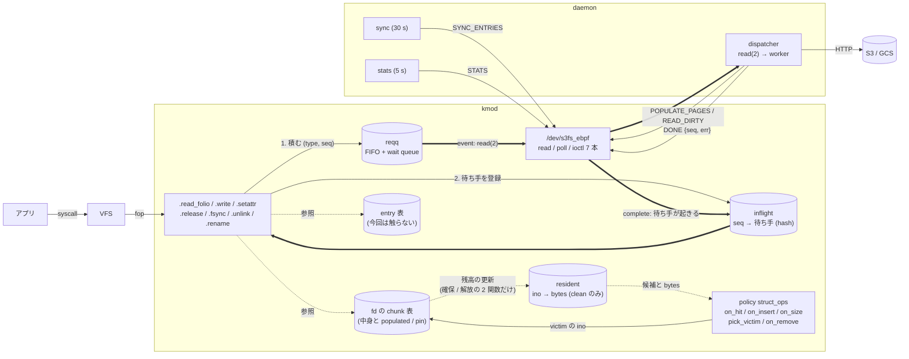
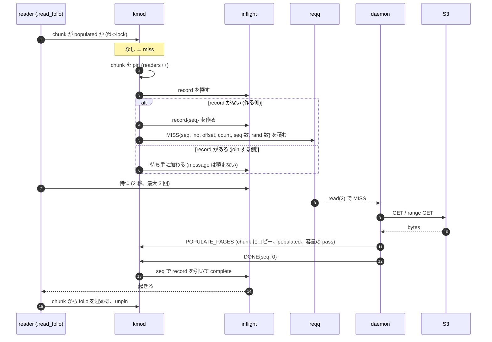
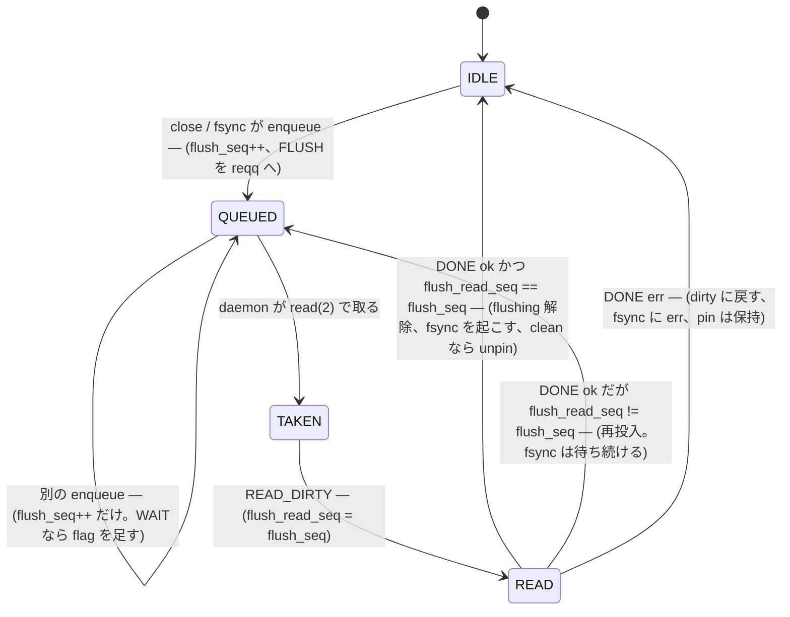

# v2 再設計: データ構造・メモリ領域・通信路を減らす

2026-11-05。**設計と spec の検証まで** (実装はまだ。コードは変えていない)。arena モードの名残、ファイルの中身の二重の帳簿、種類ごとに別々の kmod → daemon の通信路が、不変条件の多さ (R1 / S1 / C2 / F1 / W3 …) の主な原因になっている、という見立てから、構成を減らす案を出し、通信の規則を実行できるモデルで検証した。

**関連**: 現状の図は [`component-communication.md`](component-communication.md) と [`daemon-kmod-messaging.md`](daemon-kmod-messaging.md)。不変条件は [`../kmod-pcache-invariants.md`](../kmod-pcache-invariants.md)。検証用のモデルは [`v2-spec/`](v2-spec/) (`make spec-check`)。

---

## 1. 要約

| | 現状 | v2 案 |
|---|---|---|
| ファイルの中身の置き場所 | `bpf_arena` (128 MiB) + fd の chunk 表 + page cache | **chunk 表 + page cache** |
| 「何が cache にあるか」の帳簿 | admit hash (範囲、uaddr、flags) と chunk 表の **2 つ**。「entry があれば chunk がある」(R1) を lock と世代 (S1) で守る | **chunk 表だけ**。ino ごとの残高 (`resident`) は chunk の確保と解放の 2 関数が更新する |
| kmod → daemon のキュー | 5 本 (miss / flush / flush_wait / delete / rename) + evict_log | **1 本** (`reqq`) |
| 待ち手・in-flight の表 | 3 つ (`s3fs_pending` / `s3fs_flush_pending` / `s3fs_flush_pins`) | **1 つ** (`inflight`) |
| 完了の知らせ | `SIGNAL_ADMIT` / `SIGNAL_FLUSH` / `MARK_DIRTY` | **`DONE {seq, err}` 1 本** |
| ioctl | 16 | **7** (`SYNC_ENTRIES` / `POPULATE_PAGES` / `READ_DIRTY` / `DIRTY_LAYOUT` / `READ_DIRTY_RANGE` / `STATS` / `DONE`) |
| 固定の BPF map | 5 (arena / inode_index / events / counters / ino_slots) + fentry 2 本 | **0**。BPF は policy の struct_ops だけ |
| kmod の lock (spin / rw) | 10 (`admits` / `evict_log` / `pending` / `miss` / `flush` / `flush_wait` / `flush_pending` / `flush_pins` / `delete` / `rename`) | **3** (`resident` / `inflight` / `reqq`) |
| daemon の loop | 約 9 (miss、flush、flush_wait、delete、rename、sync、evict drain、stats、ringbuf) | **3** (dispatcher、sync、stats) |

効果は 3 つ。

1. **不変条件が減る。** R1 と S1 は「同じことを 2 か所が持つ」から要る規則で、帳簿を 1 つにすると消える。C2 (成功 signal の契約) と F1 (flush の queue の整合) は「同じ chunk に対する message が複数ある」「flush の message が 2 本の queue にある」から要る規則で、message を 1 つにすると要らなくなる (§6 のモデルで確認)。
2. **経路が追いやすくなる。** miss も flush も delete も「kmod が `reqq` に積む → daemon が `read(2)` で取る → `DONE` で完了」の同じ形になる。
3. **古い方式がなくなる。** arena に中身を置く方式、GUP、`ADMIT_ARENA`、flush 後の arena への書き直し (AC-82)、BPF の ringbuf と stub の index は、どれも pcache モードでは読まれていないか、読まれても結果に影響しない (§2)。

効果の見積もりは構成の数だけで、**性能への影響は未計測**。性能のゲートは §7。

---

## 2. 現状の棚卸し (数えたもの)

`grep` と関数一覧 (`scripts/fn.sh -l`) で数えた。

### 2.1 ファイルの中身を持つ領域

| 領域 | 誰が書く | 誰が読む | 状態 |
|---|---|---|---|
| `bpf_arena` (128 MiB) | daemon (mmap) | kmod が GUP (`s3fs_arena_copy_to_iter`、約 1.7 µs / page) | **既定の arena モードだけ**。pcache モードでは読み込み経路に出てこない。ただし flush 後は pcache モードでも書く (AC-82) |
| fd の chunk 表 (4 MiB の chunk) | daemon の `POPULATE_PAGES`、write | kmod の `.read_folio` / flush | pcache モードの正本 |
| page cache | kmod の `.read_folio` | アプリ (`generic_file_read_iter`) | chunk 表からの写し |

→ 2026-10-13 以降の計測と修正はすべて pcache モードで行っているのに、既定は arena モードのまま (`pcache-mode.md` §9「既定を切り替えるかは決めていない」)。

### 2.2 BPF

| 要素 | 実際に使われているか |
|---|---|
| `s3fs_arena` | arena モードの中身と stub。pcache モードでは flush 後の書き直しだけ |
| `s3fs_inode_index` (ino → arena offset) | fentry の「既知の ino か」の判定にだけ使われる。arena の stub を指すので、arena がなければ意味がない |
| `s3fs_events` (ringbuf) | **daemon が処理するのは root の ino=1 だけ。** それ以外の ino は何もしない (`daemon-kmod-messaging.md` §7)。kmod は読まない |
| `s3fs_counters` | fast_hits / slow_misses は `inode_index` の判定の結果。read_iter の hit 数も同じ前提 |
| `s3fs_ino_slots` | fentry が ino ごとの seq / rand を数える。daemon が `ReadAccessPattern` で読み、大きいファイルの全体 admit の判定 (R-01) に使う。**これだけは意味のある情報** |
| fentry `vfs_getattr_nosec` / `generic_file_read_iter` | 上の 5 つを更新する。on_hit の forward は `hit_accum=1` (既定) では何もしない |
| fentry の `policy_hit` KFunc | `hit_accum=0` のときだけ有効 |
| syscall プログラム 3 本 (`deep_walk_reject` / `arena_prealloc` / `test_shared`) | verifier のデモと arena のテスト用 |
| policy の struct_ops | **本体**。policy ごとに自分の map を 0〜8 個持つ (`wtinylfu_pick` が 8) |
| fmod_ret (Layer 2) | `component-communication.md` §5 の図にあるが、kmod に `s3fs_policy_on_*` の anchor が見つからない (grep)。**doc だけに残っていた層** (`component-communication.md` は直した。`policy-attach-comparison.md` は issue #35 で削除済みと明記済み) |

### 2.3 kmod の表とキュー

| 構造 | 用途 | v2 での扱い |
|---|---|---|
| `s3fs_admits` (hash、範囲) + `s3fs_admits_lock` (rw) + `s3fs_admit_gen` | arena の範囲と PCACHE entry | **廃止** → `resident` |
| `s3fs_evict_log` (512 件) | daemon の oscillation 防止 | **廃止** (daemon は admit を再送しない) |
| `s3fs_pending` (hash) | miss の待ち手 | `inflight` に統合 |
| `s3fs_flush_pending` (hash) | fsync の待ち手 | `inflight` に統合 |
| `s3fs_flush_pins` (list) | PUT 前の inode を保持 | fd のフラグ + `inflight` |
| `s3fs_miss_events` / `s3fs_flush_queue` / `s3fs_flush_wait_queue` / `s3fs_delete_queue` / `s3fs_rename_queue` | kmod → daemon | `reqq` に統合 |
| `s3fs_local_entries` / `dyn_entries` / `attr_overrides` | ディレクトリの内容 | **今回は触らない** |

### 2.4 通信の複雑さの根っこ: miss の message が reader ごとに積まれる

`.read_folio` の upcall (`aops_read.inc.c`) は、`pending_get_or_create` で同じ (ino, chunk) の待ち手を共有するが、**`miss_enqueue` は pending を作った reader だけでなく、join した reader も呼ぶ。** 同じ chunk を待つ reader が N 人いれば、daemon には同じ chunk の miss が N 件届き、N 個の handler が同じ chunk を取りに行く。

ここから次の機構が生まれている。

- 先に終わった handler が pending を完了させ、遅れた handler は pending に守られないまま evict される → その handler が「成功」を signal すると、別の reader が空の chunk で起こされる (C2)。
- これを止めるために `VERIFY_POPULATED` と `signalVerifyRetries=3` と daemon の再 populate (`read_miss_repopulates_total`)。**3 回使い切ると検証なしで signal する**ので、完全には止まらない (§6.1 の RM-2)。
- 同じ ino の load を daemon が登録し、後から来た handler は待つだけにする (`admit_chunkload.go`)。GET を二重に出さないため。

message を「in-flight の record を作った reader だけが積む」にすれば、同じ chunk の handler は常に 1 つになり、上の 3 つは要らない。

---

## 3. 設計方針

1. **帳簿は 1 つ。** ファイルの中身がどこにあるかは chunk 表だけが答える。別の表に写しを持たない。
2. **message は 1 つの口。** kmod が daemon に頼むことは、種類によらず `reqq` に 1 件積む。daemon は `read(2)` で 1 件ずつ取り、終わったら `DONE` を 1 回返す。
3. **message と完了は 1 対 1。** 完了は `seq` で引く。(ino, chunk) のような key で引かない。古い message の完了が新しい待ち手を起こす事故が構造上ない。
4. **容量は kmod が守る。** daemon は admit の snapshot を持たない。evict の判断も結果も kmod の中で閉じる。
5. **BPF は policy だけ。** 実データも状態も kmod が持ち、BPF は順序を決める。

---

## 4. 新しい構成

### 4.1 全体図

矢印の意味は既存の doc と同じ (太線 = event・データ、実線 = 呼び出し、点線 = 参照)。

### 4.2 データ面: chunk 表が唯一の帳簿

**`resident`** は ino をキーにした xarray で、値は `{ino, bytes}`。**clean で `cap > 0` の fd だけ**が載る。

- 更新するのは `s3fs_fd_chunk_ensure` / `s3fs_fd_chunk_free` (いまも `fd->cap` を変える唯一の 2 関数、M1 / M2) と、fd が dirty ⇄ clean になる所だけ。すべて `fd->lock` の下。lock 順は `fd->lock` → `resident_lock` で、今の `fd->lock` → `s3fs_admits_lock` と同じ形。
- **entry の存在は残高から決まる** (`bytes > 0` ⟺ 載っている)。「entry があるのに chunk がない」状態を作れない。R1 / S1 / 世代 (`s3fs_admit_gen`) / lockless の `fc_pcache_check` / 「entry の入れ直し」が要らなくなる。
- hit の判定は chunk の `allocated && populated` (T2) だけ。`.read_iter` は常に `generic_file_read_iter` に渡す。
- evict は「`readers == 0` の chunk を free し、`fd->lock` を離したあとでその範囲の page cache を落とす」の 1 種類。いまの「丸ごと evict」と「shed」(miss が in-flight の ino は丸ごとは消さない) は、**pin が守るので区別が要らない** (丸ごと evict = 全 chunk が unpinned だった shed)。
- 容量の pass (`admit_replace` の evict 部分) は、`POPULATE_PAGES` の最後、daemon に戻る前に kmod が走らせる。いまの `enforceCapacityAfterPopulate` (daemon が `ADMIT_ARENA` を再送して pass を起こす) の代わり。populate → pass → `DONE` の順は変わらないので、この miss の chunk は reader の pin で守られる。

### 4.3 通信面: `reqq` + `inflight` + `DONE`

`read(2)` が返す message (種類は `type`):

| type | 旧 | 待つか | 主なフィールド | 完了 (`DONE`) の意味 |
|---|---|---|---|---|
| `MISS` | read の miss | 同期 | ino, offset, count, flags (`FOR_WRITE` / `PINNED`), seq 数 / rand 数 | chunk が populate された (または err) |
| `STAT` | open_check | 同期 | ino | 0 / `-ENOENT` / `-EIO` |
| `FLUSH` | close / fsync | close は非同期、fsync (`WAIT`) は同期 | ino, parent_ino, size, name, flags (`WAIT`) | PUT の結果。err なら kmod が dirty に戻す (旧 `MARK_DIRTY`) |
| `DELETE` | unlink | 非同期 | ino, parent_ino, name | 受領 |
| `RENAME` | rename | 非同期 | ino, 旧 / 新 parent_ino と name | 受領 |

- 先頭の共通ヘッダは `{seq, type, flags, len, ino}`。`seq` は kmod が振る 64 bit の通し番号。`len` で可変長 (名前の分) を返し、バッファが足りなければ `-EINVAL` (いまと同じ)。
- **`MISS` はこれまで通り「ino の中の chunk」単位で待ち手を共有するが、message は record を作った reader だけが積む** (規則 Q-1)。
- `DONE {seq, err}` は seq で `inflight` の record を引く。**知らない seq は `-ENOENT` で何も起きない** (規則 Q-2)。
- `inflight` は ino をキーにした hash (いまの `s3fs_pending` の P1 と同じ。`pending_exists(ino)` の走査が bucket 1 つで済む)。record は `{seq, type, ino, chunk, waiters, err}` で、参照は 2 本立て (hash の分 + 待ち手の分、H-06) のまま。
- **FLUSH は ino ごとに 1 つの枠 (slot)** を fd に持つ (規則 F-1)。`IDLE → QUEUED → TAKEN → READ → IDLE`。枠が忙しいときの 2 回目以降の enqueue は `flush_seq` を進めるだけで、新しい message は積まない。`DONE` のとき `flush_read_seq == flush_seq` なら完了、違えば枠を `QUEUED` に戻す (規則 F-3)。F1 (kmod が queue の item を捨てる) は、枠が 1 つなので要らない。
- 順序は `reqq` の FIFO のまま。daemon は **同じ ino の FLUSH / DELETE / RENAME を順に実行**し (いまの `flush_order.go` を広げる)、`MISS` / `STAT` は ino 内でも並列にする (AC-52 の chunk 並列取得のため)。いまは flush と delete が別の queue を別の ticker で取るので、書いて close した直後の unlink で順序が入れ替わりうる (**コードでは追っていない。可能性として挙げる**)。

### 4.4 BPF 面

- **残す**: policy の struct_ops (`on_hit` / `on_insert` / `on_size` / `pick_victim` / `on_remove`、旧世代の `on_admit` / `on_evict` / `on_pressure` は §8 の D2) と、policy 自身の map。`policy_stats`。
- **外す**: `s3fs_arena` / `s3fs_inode_index` / `s3fs_events` / `s3fs_counters` / `s3fs_ino_slots` と fentry 2 本。
- **read の pattern (seq / rand)** だけは意味があるので kmod に移す: `.read_iter` はすでに fd の per-CPU 値 (`fd->hit`、hit_accum) を進めているので、そこに `last_end_pos` と seq / rand を足す。daemon へは **`MISS` message のフィールド**として渡す (map を読みに行かない)。fentry と同じ判定 (前の read の終端からの slack 4 KiB)。
- **verifier のデモ / arena のテスト** (`deep_walk_reject` / `arena_prealloc` / `test_shared` と arena の map) は `bpf/demo/` の別の object に分け、デモのコマンドだけが読み込む。本番の `fastpath` の object はなくなる。
- fmod_ret の層は doc から消す (コードにはもうない)。

### 4.5 daemon

- 消す: `internal/arena`、`WarmCache` と `s3fs_inode_index` への書き込み、ringbuf の reader、`prewarm_arena.go`、`arena_seq_prefetch.go`、`probe_kvbase.go`、`admit_arena.go` の snapshot / `refreshAdmits` / `dropAdmits`、`drainEvictionsLoop`、flush 後の `AdmitContent` (AC-82)、`--arena-metadata-only` (常に pcache)。
- 1 本にする: `runReadMissLoop` / `runFlushLoop` / `runFlushWaitLoop` / `runDeleteLoop` / `runRenameLoop` を dispatcher 1 つ (`read(2)` → type ごとの worker)。
- 残す: coalescer (close の連続を 1 PUT に集約する 200 ms の debounce)、`flush_order`、partial modify (AC-51)、chunk の並列取得 (AC-52、ino ごとの load の登録は要らなくなる)、prewarm (AC-67) / `prefetch_next` (AC-68)、sync、stats。
- `fpebpf.LookupByIno` (daemon の ino 表、実体は Go の map) は `ebpf` パッケージから出す。移し先は `inostate`。

### 4.6 ioctl の対応

| 旧 | v2 |
|---|---|
| `PROBE_KVBASE` | 廃止 (spike) |
| `ADMIT_ARENA` | 廃止 |
| `SIGNAL_ADMIT` / `SIGNAL_FLUSH` / `MARK_DIRTY` | `DONE` |
| `POP_FLUSH` / `POP_FLUSH_WAIT` / `POP_DELETE` / `POP_RENAME` | `read(2)` + `poll(2)` |
| `DRAIN_EVICTIONS` | 廃止 |
| `SYNC_ENTRIES` / `POPULATE_PAGES` / `READ_DIRTY` / `DIRTY_LAYOUT` / `READ_DIRTY_RANGE` / `STATS` | そのまま (`READ_DIRTY` は `READ_DIRTY_RANGE` の offset=0 に寄せれば 6 本になる。必須ではない) |

---

## 5. 主な流れ

### 5.1 read の miss

### 5.2 flush (close と fsync)

### 5.3 evict

capacity を超えたとき (`POPULATE_PAGES` の最後、`SYNC_ENTRIES` のあと) に kmod が pass を走らせる: Phase 1 で `resident` の各 ino に `on_hit` の再生 → `on_insert` → `on_size`、超過なら `pick_victim` が返した ino の unpinned chunk を free して page cache を落とし、`on_remove`。ここまでは今と同じで、**evict の結果を daemon に返さない。**

---

## 6. spec と検証

### 6.1 read miss の規則とモデル (`v2-spec/readmiss_model.py`)

| 規則 | 内容 |
|---|---|
| Q-1 | `MISS` を積むのは in-flight record を作った reader だけ。join した reader は積まない |
| Q-2 | `DONE` は seq の record だけを完了する。知らない seq は `-ENOENT` で無効 |
| Q-3 | reader は record を作る (join する) **前**に chunk を pin する |
| D-1 | `resident` は clean で `cap > 0` の fd だけを載せ、残高 = `fd->cap`。更新は `chunk_ensure` / `chunk_free` / dirty ⇄ clean の遷移だけ (`fd->lock` の下)。**構成上の規則で、モデルの対象外** |
| D-2 | hit は chunk が `allocated && populated` のときだけ。ほかの状態を見ない (対象外) |
| D-3 | evict は pin された chunk を free しない |
| Q-4 | device が close されたら、in-flight の `MISS` / `STAT` を `-EIO` で起こし、FLUSH の枠を dirty に戻す。**規則として書いただけで、モデル検査していない** |

モデル: 1 inode、reader、daemon の handler、evictor。reader は「chunk を確認 → pin → record を作る/join → 待つ → 起きたら確認し直す」を、retry の上限つきで行う。evictor は pin されていない populated の chunk をいつでも free できる。**性質: daemon が健全 (timeout なし) なら、reader は spurious な EIO にならない**。timeout ありのときは deadlock がなく pin が釣り合うこと。

規模は縮小している (reader 4、handler 3、evict 4 回、retry 上限 1。コードの `S3FS_UPCALL_MAX_RETRIES` は 3)。retry を 1 に縮めると、C2 の「古い signal が retry を使い切る」が到達可能になる。

| id | 設定 | 結果 | 意味 |
|---|---|---|---|
| RM-1 | 現行 (reader ごとに enqueue、key で完了、verify は諦めない) | ok | verify が諦めなければ現行は安全 |
| RM-2 | 現行、verify は 2 回で諦める (`signalVerifyRetries` 相当) | **反例** | 古い handler の signal が新しい reader を起こし、retry を使い切る |
| RM-3 | 現行、verify なし | **反例** | AC-45 C2 の再現 |
| RM-4 | **v2** (record ごとに enqueue、seq で完了、verify あり) | ok | |
| RM-5 | v2、verify なし | ok | **`VERIFY_POPULATED` は正しさに要らない** |
| RM-6 | record ごとに enqueue だけ (key で完了) | ok | Q-1 だけでも足りる |
| RM-7 | seq で完了だけ (reader ごとに enqueue) | ok | Q-2 だけでも足りる |
| RM-8 | v2、pin なし | **反例** | Q-3 は要る |
| RM-9 | v2、chunk 2 つ | ok | |
| RM-10 | v2、daemon の timeout あり | ok | deadlock なし、pin の釣り合い |

読み取れること。

- **現行の C2 対策 (verify) は、再試行を使い切るまでの範囲でしか効かない** (RM-2)。v2 は、同じ chunk の message が 1 つで完了が seq なので、古い handler が存在せず、この性質に頼らない (RM-5)。
- Q-1 と Q-2 のどちらか 1 つで十分だが、**両方入れる**: Q-2 は FLUSH / DELETE / RENAME に必要 (同じ ino に複数の message が同時にある) で、Q-1 は daemon の重複 GET を止める。
- 判断: verify (`VERIFY_POPULATED`) と daemon の再 populate は **削除できる**。ただし kmod 内の「populated でなければ待ち手を起こさず `-EAGAIN`」は、実装が単純なので安全弁として残してよい (RM-4)。

### 6.2 flush の規則とモデル (`v2-spec/flush_model.py`)

| 規則 | 内容 |
|---|---|
| F-1 | ino ごとの flush の枠は 1 つ。busy のときの enqueue は `flush_seq++` だけ |
| F-2 | `READ_DIRTY` が `flush_read_seq = flush_seq` を記録する (バッファが足りないときは何も記録せず `-ENOSPC`、AC-71) |
| F-3 | `DONE ok`: `flush_read_seq == flush_seq` なら完了 (fsync を起こす、clean なら unpin)。違えば枠を `QUEUED` に戻す (fsync は待つ) |
| F-4 | `DONE err`: dirty に戻し、fsync に err、pin は保持 |
| F-5 | `reqq` は FIFO。daemon は同じ ino の FLUSH / DELETE / RENAME を順に実行する (**モデル外**) |
| F-6 | WAIT の enqueue が、daemon が預かっている (debounce 中の) 同じ ino の分を急がせる message (kick、同じ seq) を積む。タイミングだけの規則 (**モデル外**) |

モデル: writer、close、fsync、daemon (take / READ_DIRTY / PUT ok / PUT fail)。性質は 6 つ。

1. **書いたものを失わない**: オブジェクトが古いなら、fd が dirty か flushing
2. flushing なら inode が pin されている
3. 枠が busy なら flushing
4. flushing なら request が存在する (置き去りにならない)
5. fsync が待っているなら flush が進行中 (永遠に寝ない)
6. **fsync が 0 を返したなら、オブジェクトは fsync が要求した時点の内容を持つ**

| id | 設定 | 結果 |
|---|---|---|
| FL-1 | v2 (write 2、close 2、fsync 1、PUT 失敗 1) | ok |
| FL-2 | v2、規模を大きく (write 3、close 3、fsync 2、失敗 2) | ok |
| FL-3 | `flush_read_seq` を見ない | **反例**: PUT が読んだ後の write が失われる (W3 と同じ種類) |
| FL-4 | 枠を 1 つにまとめたが、seq 不一致で再投入しない | **反例**: fsync が永遠に待つ |

FL-4 は **枠を 1 つにまとめる設計に固有の落とし穴**: 今は enqueue のたびに message があるので不一致でも次の message が処理するが、枠にまとめると再投入 (F-3) を kmod が持たなければならない。この規則を実装の要件に入れる。

### 6.3 既存の不変条件の行き先

`../kmod-pcache-invariants.md` の各項目が v2 でどうなるか。

| 不変条件 | v2 |
|---|---|
| lock 順 `fd->lock` → `s3fs_admits_lock` | `fd->lock` → `resident_lock`。pending / miss / flush_* の spinlock は `inflight_lock` / `reqq_lock` に。どちらも末端 |
| **R1** (entry があれば chunk がある) | **消える**。entry = 残高で、`bytes > 0` ⟺ 載る。構成上の議論であり、モデル検査の対象ではない (§6.4) |
| **S1** (lockless の `fc_pcache_check` のあとの世代確認) | **消える**。lockless な entry 判定がない |
| T1 (dirty の hole は 0) / T2 (populated を要求) / T5 (chunk 全体を覆うときだけ populated) / EOF | 変わらない (chunk 表の規則) |
| pending のキー (ino, chunk)、P1、U13 | `inflight` (ino が bucket、(ino, chunk) で join、完了は seq) |
| H-06 (参照 2 本立て) | 変わらない |
| `pending_exists(ino)` による丸ごと evict の回避 | pin が守るので evict 側では不要。policy の `s3fs_policy_trackable` は `inflight_exists(ino)` で残す |
| open_check の `U64_MAX` key | `STAT` message。key の特例が要らない |
| **成功 signal の契約 (C2)**、`VERIFY_POPULATED`、`signalVerifyRetries`、daemon の再 populate | Q-1〜Q-3 で不要 (RM-5)。kmod 内の検査だけ残す |
| `enforceCapacityAfterPopulate` | `POPULATE_PAGES` の中で kmod が行う |
| chunk の pin (U8、C3) | 変わらない |
| data-based fill / entry の入れ直し | **消える** (entry がない。hit は chunk の populated だけ) |
| reset の条件 (S4、`s3fs_file_data_reset`) | evict が chunk を直接 free する。「entry を落としたと報告したときだけ」の判定は不要 |
| AC-41 / M1 / M2 (`fd->cap`、`s3fs_fd_buf_audit`) | 変わらない。`resident` の元になる |
| AC-45 C1 (chunk 表) / C3 (shed) | C1 は変わらない。shed は一般の evict に統合 |
| AC-50 / AC-51 (変更の前の読み込み、partial modify、ETag の pin) | `FOR_WRITE` / `PINNED` は `MISS` の flags のまま。変わらない |
| AC-76 (readahead / large folio) | `fc_pcache_check` と S1 の部分が消えるだけ |
| hit_accum (issue #22) | 既定のまま。`hit_accum=0` の経路と fentry の forward は消える |
| sync (`entries_replace` が同じ listing なら shrink しない) | 変わらない |
| flush pin (W1) | fd のフラグ + F-3 / F-4。残った pin の解放は `put_super` で `inflight` を走査 |
| W3 / AC-71 | F-2 / F-3 (FL-3) |
| F1 (kmod が queue の item を捨てる) | **消える** (枠が 1 つ、F-1) |
| F1 daemon 側 (`cancelParked`) | WAIT の enqueue が、daemon が預かっている同じ ino の分を急がせる message (kick) に置き換わる (F-6)。タイミングだけの話で、モデルには入れていない |
| AC-48 (`admit_replace` が i_size を entry の範囲まで伸ばす)、AC-56 | **要確認**。entry がなくなる。i_size は `SYNC_ENTRIES` の size を正本にできるが、flush で作ったファイルと sync の間の扱いは実装前に読む |
| AC-57 (dirty な fd に entry を入れない) | `resident` は clean だけ (D-1) |
| AC-58 / AC-64 / AC-66 (policy) | 「admit set」を「resident」と読み替える。仕様は変わらない |

### 6.4 モデルが見ていないこと

- **lock と memory ordering。** モデルの 1 step は atomic。`resident` と chunk の更新が `fd->lock` の下で一緒に行われるかは、実装のレビューと lockdep (`make test-lockdep`)、KUnit で見る。
- R1 / D-1 の「entry = 残高」は、構成上の議論。モデルは chunk を populated / absent の 1 ビットで持ち、残高を別に持たない。
- partial modify の remote chunk、dirty な fd の読み、複数 inode、DELETE / RENAME の順序 (F-5)、daemon が落ちたときの規則 (Q-4: device の release で MISS を `-EIO` で起こし、FLUSH の枠を dirty に戻す。**規則として書いただけで、モデル検査していない**)。
- WAIT の kick (タイミング) と、daemon の coalescer の debounce。
- retry の上限と規模は縮小している。結果は「この規模の全状態で反例なし」で、規模を超えた一般性は主張しない。

---

## 7. 移行手順

各 Phase は単独で出せ、`make test-regression` を通す。性能は Phase 2 と 4 のあとに測る (`perf-bench-verify` の手順)。

| Phase | 内容 | リスク | 主な確認 |
|---|---|---|---|
| 0 | この設計と spec のモデル (済) | — | `make spec-check` |
| 1 | **死んでいる経路を消す**: ringbuf と daemon の ino=1 の warm、fentry `getattr`、`s3fs_counters` の stub 関連、`hit_accum=0` の経路、`PROBE_KVBASE`、doc の fmod_ret の層 | 低 | `make test-regression`、`make test-daemon` |
| 2 | **pcache だけにする**: `--arena-metadata-only` を常に有効にし、arena の読み書き (GUP、`ADMIT_ARENA` の uaddr、`AdmitContent`、AC-82 の書き直し、arena の prewarm) を消す。arena のデモは `bpf/demo/` へ | 中 (既定が変わる) | 性能のゲート (下)、`test-arena*` を整理 |
| 3 | **`resident` で admit hash を置き換える**: R1 / S1 / 世代 / `fc_pcache_check` を消す。capacity の pass を `POPULATE_PAGES` の中へ。`ADMIT_ARENA` / `DRAIN_EVICTIONS` を消す。fentry `read_iter` を外し、pattern を kmod の `.read_iter` と `MISS` に移す | 高 (kmod の中心) | `test-pcache-evict-race`、`test-evict-readback`、`test-pcache-capacity-*`、`test-lockdep`、KUnit、`test-pattern-aware-admit` を `MISS` のフィールドで作り直す |
| 4 | **`reqq` + `inflight` + `DONE`**: 5 本の queue と 3 つの表を統合。flush の枠。daemon の dispatcher | 高 (daemon との同時変更。バージョン交渉がないので kmod と daemon を同時に作り直す) | `test-fsync-*`、`test-write-*`、`test-open-check`、`flush_order_test.go`、モデルとの突き合わせ |
| 5 | (§8 D2) 旧世代の policy と softcap を消す | 中 | `test-policy-*`、hit-rate bench の対象の見直し |

**性能のゲート** (Phase 2 の前に、現行の pcache モードの値を基準に取る): 64 jobs の psync read (fuse-raw 比 0.983 以上、`benchmark-results.md` §18.43)、100 MiB の cat (14.7 ms)、小さいファイル 10,000 個の warm cat、新規 100 MiB の fsync (AC-82 の書き直しがなくなるので速くなるはず)、cold の大きいファイル。**`.read_iter` に seq / rand の per-CPU 更新が増える**ので、64 jobs の read は Phase 3 で特に見る (fentry の分は減る)。

---

## 8. 決めてほしいこと

| # | 論点 | 推奨 | 理由・代償 |
|---|---|---|---|
| D1 | BPF の fentry (観測) を外し、read の pattern を kmod に移す | **外す** | map が 5 → 0。代償は「eBPF が観測する」というデモの話が policy だけになる。pattern は policy に `on_hit` の引数として渡す形で eBPF 側に戻せる (後から) |
| D2 | 旧世代の policy (score 型: `on_evict` の vote、`on_admit` / `on_pressure`) と softcap の legacy モード (`capacity_bytes = 0` で softcap を使う) を消す | **別 PR で** (Phase 5) | vtable と admit_replace の分岐が半分になる。代償は、score 型と比べる hit-rate bench と demo の作り直し。D2 を先に決めないと、Phase 3 の capacity の pass が両方の世代を持つ |
| D3 | arena のデモ (Meetup の発表の一部) の扱い | `bpf/demo/` に分け、`--demo arena` で動かす。pcache を既定にする | 発表の流れは変わらず、本番の経路から外れる |
| D4 | 既定を pcache に切り替える時期 | Phase 2 の性能のゲートを通ったら | `pcache-mode.md` §9 の「決めていない」を決めることになる |

---

## 9. 確認状況 (2026-11-05)

**確認した:**
- 棚卸しの数 (BPF map、fentry、ioctl 16、lock 10、queue / 表) は `grep` と関数一覧で数えた。
- `miss_enqueue` が join した reader からも呼ばれること (`aops_read.inc.c` の upcall)。
- fmod_ret の anchor がコードにないこと (`s3fs_policy_on_*` の grep)。
- 2 つのモデルは `make spec-check` で全シナリオが期待どおり (反例が出るべき 5 つは出て、ok のべき 9 つは ok)。反例のうち RM-3 は、過去の C2 と同じ種類 (古い signal が retry を使い切る) であることを trace で確かめた。

**確認していない:**
- **実機・実装は何も変えていない。** v2 の性能は未計測。
- モデルは §6.4 のとおり lock、複数 inode、partial modify、DELETE / RENAME の順序、daemon の障害を見ていない。
- daemon の `internal/admit` の中身と、`admit_snapshot` (flush 後の arena の読み) 以外の admit hash の使われ方は全部は追っていない。Phase 3 の最初に `grep` で全呼び出し元を出す。
- AC-48 / AC-56 の i_size の扱い (§6.3)。
- 削除される行数の見積もりはしていない (Phase 1 から数える)。

## 9.1 実施状況 (2026-11-05)

- Phase 1: PROBE_KVBASE (#48)、`hit_accum=0` の経路 (#49)、doc の fmod_ret の層 (#50)、ringbuf と ino=1 の warm (#51)。残り: `s3fs_counters` の stub 関連と getattr の fentry (`s3fs_inode_index` が Phase 3 まで要るので Phase 3 と一緒)。
- Phase 2 (pcache だけにする): arena の読み (kmod の GUP)・書き (daemon の `AdmitContent`、content prewarm、arena の先読み、flush 後の書き直し) を削除し、AC-82 の kmod 側 (`SIGNAL_FLUSH` 成功で PCACHE entry を入れ直す) を入れた。`ADMIT_ARENA` は `count == 0` だけ受ける。`--arena-metadata-only` は何もしない旧フラグ。**`make test-regression` 28 件 PASS**。
  - arena の書き直しが隠していた既存の穴が 2 つ出たので直した: (1) 新規に作って evict されたファイルの read miss を daemon が `ENOENT` にしていた (entry 表は次の sync まで知らない → `localKeys` + S3 の Stat で解決)、(2) flush の通常 PUT のあと entry 表のサイズが古いまま (縮めた後の全体 admit が EOF を超えた)。
- Phase 3a: read pattern (seq / rand) を kmod の `.read_iter` で数え、`s3fs_read_miss_event` (24 → 32 B) で daemon に渡す。fentry `generic_file_read_iter`、`s3fs_ino_slots`、KFunc `s3fs_kfunc_policy_hit`、`--no-read-iter-hook` (旧フラグ、no-op) を削除。IOC_STATS の slot 3 / 4 は GUP の数から `.read_iter` の呼び出し数 / 先頭の read 数に転用。`make test-regression` 28 件 PASS。
- Phase 3b: `ADMIT_ARENA` を引数なしの `EVAL` に置き換え (kmod の容量パス `s3fs_ebpf_capacity_pass` を走らせる)、upcall の有効化は daemon の mm ではなくデバイスの open (`s3fs_daemon_armed`) に。`evict_log` + `DRAIN_EVICTIONS`、daemon の admit 表 (`internal/admit`)、arena の allocator / free-list、AC-48 / AC-56 を削除。ioctl は 13 本。`make test-regression` 28 件 PASS。
- 単体テスト: Go (`readmiss_v2_test.go`: 事象のデコード、pattern 比、`entryForMiss`、pattern による全体 admit の判定、`evalPass`、flush 後のサイズ更新。意図的に壊して失敗することも確認) と KUnit (read pattern と miss event、flush 成功時の PCACHE entry (AC-82)、容量パス、upcall の有効化)。**KUnit は UML 環境がなく実行していない** (`CONFIG_KUNIT=m` でのコンパイルだけ確認)。
  - 残り (Phase 3 で消える): `internal/admit` の daemon 側の表と arena の free-list、`s3fs_arena` map と stub、kmod の admit hash の uaddr / mm の扱い。

## 10. 更新運用

- 実装の Phase が入ったら、`component-communication.md` / `daemon-kmod-messaging.md` / `../kmod-pcache-invariants.md` / `pcache-mode.md` を同じ変更で直す (CLAUDE.md の約束)。
- モデルを変えたら `v2-spec/run.py` の期待を直し、`make spec-check` を通す。規則 (Q-* / F-* / D-*) を変えたら §6 の表も直す。
